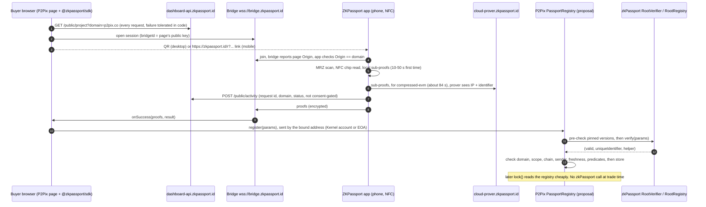

# zkPassport for P2Pix: research report for design, front-end and contracts

**Date:** 2026-10-10. The task was dated 2026-10-08; the inputs were fact-checked on 2026-10-09 and 2026-10-10.
**Repo state read:** front-end branch `reputation` @ `63aaa73`; contracts submodule @ `c4414b4` (written `sc/` below); `origin/zkpix` @ `591f977`; front-end `origin/zk` @ `46cde87`.
**Purpose:** let the user (1) design the UI, (2) build the front-end, (3) change the contracts last.
**Scope:** zkPassport is the subject. The only alternatives covered are the two Brazil-specific ones: gov.br facts proven with Primus zkTLS, and the national ID card (CIN). No other identity provider is compared.

**How this report was built.** It merges nine research notes in this folder: `zkpassport.md`, `sdk.md`, `p2pix-fit.md`, `crops.md`, `brazil-govbr-zktls.md`, `brazil-cin.md`, `verify-facts.md`, `verify-fit.md` and `verify-brazil.md`. Where they disagree, the later correction is used.
- **Re-checked on 2026-10-10 for this synthesis (measured):**
  - `@zkpassport/sdk` `latest` is still 0.18.2.
  - `@zkpassport/utils` 0.39.0 still declares no licence.
  - `@obsidion/bridge` 0.12.2 is Apache-2.0.
  - `eth_getCode(0x1D000001000EFD9a6371f4d90bB8920D5431c0D8)` returns code on Ethereum and Sepolia, and `0x` (no contract) on Arbitrum One and Rootstock testnet.
  - The EF Mandate is unchanged (md5 `a397e9da…`; local copy `vfit-dl/mandate-20261010-synth.md`).
- **Completeness pass (2026-10-10, later the same day).** A critic pass added §2.4 lifecycle limits, Brazil evidence in §2.5, §3.10 (mobile-only users), fiat costs in §3.5, §4.3 (what a seller actually learns), §4.4 (abuse and lifecycle), the AA fee-routing finding in §5.4, the pre-connect and edge states in §6.4, corrected seller-disclosure copy in §6.7, and the LGPD, minors and tax-threshold notes in §7.5. New measurements and fetches for that pass:
  - the Mandate was re-fetched and still has md5 `a397e9da…` (`critic-dl/mandate-20261010-critic.md`);
  - a public Brazilian-passport report: [zkpassport/circuits#129][gh-129];
  - the Polícia Federal pages on passport validity and renewal ([gov.br][govbr-passport], [PF FAQ][pf-renew]);
  - the Brazilian CSCA validity windows, read from the certificate package (`dl2/certs_latest.json`);
  - the bridge replay cache and reconnect-on-wake behaviour, read from the bridge README and `@obsidion/bridge` 0.12.2 source;
  - the app's `returnDeepLink` handling ([AccessRequestView.tsx][app-arv]);
  - the repo's AA fee routing (`src/blockchain/aa/operations.ts:111-165`);
  - the zkPassport ToS eligibility clause ([ToS][zkp-tos] §4);
  - an ETH-BRL quote of R$ 12,597 on 2026-10-10 ([Mercado Bitcoin public ticker][mb-ticker], saved to `critic-dl/`).
- **No repo file was modified.** Downloaded material was treated as untrusted data.
- **Not legal advice.** Every statement about Brazilian law is a reading of primary text and needs counsel.

**Markers**

| Marker | Meaning |
|---|---|
| **UNVERIFIED** | Not confirmed from a primary source, or the public code shows it but the shipped app may differ |
| **(measured)** | A read-only RPC, npm or bundle measurement made by these research runs |
| **Inference** | The researchers' own reasoning |
| **Estimate** | The researchers' own number, not measured |
| **Proposal** | A design sketch for P2Pix, not an existing API |

**Letter keys used below** (the input notes use clashing letters, so this report fixes one set):
- **Architecture options:**
  - **A**: verify a proof inside every `lock()`.
  - **B**: register once in an on-chain registry.
  - **C1**: the seller's browser verifies a proof and adds the buyer to the existing Merkle allowlist.
  - **C2**: a service verifies proofs for sellers.
  - **D**: an EAS attestation.
  - **E**: hybrid, made of B, a per-offer policy, a pluggable gate, and C1 as a bridge until contracts change.
  - **F**: anonymous membership.
- **Features:** F1–F15, defined in §4.

---

## 1. TL;DR

1. **Can zkPassport do "only passport-verified buyers"? Yes, but not with today's contracts, and today only on Ethereum and Sepolia.**
   - zkPassport can prove "holder of a valid, unexpired chip passport, bound to this wallet, with one identifier per document". Brazilian passports have full support in zkPassport's registry (level 1.0).
   - One public Brazilian attempt exists ([circuits#129][gh-129], 2026-03-29). The MRZ scan and the NFC read worked, and proving then failed in the FaceMatch circuit. A zkPassport contributor replied that Brazilian passports are "all supported" and blamed a FaceMatch bug. A **successful** Brazilian proof is still **UNVERIFIED** (§2.5).
   - Today's allowlist is a **bypass** of the reputation limit, not a gate (`sc/contracts/p2pix.sol:167-186`). An exclusive gate needs a contract change.
   - The verifier exists on Ethereum and Sepolia (plus Base and Robinhood Chain). It does **not** exist on Arbitrum One or Rootstock testnet (re-measured 2026-10-10).
2. **Ship first, with no contract change, on all four networks:**
   - an honest allowlist ("VIP list") UI;
   - matcher awareness of VIP lists;
   - "Request VIP access with zkPassport" (option C1): the seller's own browser verifies the proof and adds the proof-bound address with the existing `setRoot`.
   - The UI must label this as **"sem limite de reputação"** ("no reputation limit"), never as "somente" ("only").
3. **Target design for the contracts phase:**
   - a register-once `PassportRegistry`, about 1.1–1.45 M gas per registration (**Estimate**, bracketed by measured 1.28–1.45 M issue transactions);
   - a per-offer `BuyerPolicy`, checked in `lock()` for about 10–20 k gas (**Estimate**);
   - a **seller-chosen, pluggable gate**: zkPassport, gov.br via Primus, the Merkle list, and later a bond.
   - Arbitrum comes later, through an upstream deployment or an L1→L2 retryable relay. Rootstock testnet stays without the feature.
4. **Other features worth doing**, all seller-chosen:
   - age 18+;
   - "document valid at least 90 more days";
   - "verify only above X BRZ";
   - a **per-person daily cap**;
   - a **seller-scoped "block this person"**.
   - FaceMatch and sanctions only under "Avançado" ("advanced").
5. **Not in v1:**
   - Nationality filters: legal risk under Lei 7.716 and CDC art. 39 IX, and exclusionary by design.
   - One-person reputation, and a verified-holder reputation tier: protocol-wide, so team debate first.
   - Matching the Pix payer's name to the passport name: research only.
6. **Brazilian alternatives:**
   - **CIN:** no chip, and the QR spec and keys are secret by decree. It is **not** a selectable gate.
   - **gov.br account level via Primus zkTLS:** possible only after a 1–2-day go/no-go spike (the session may be IP-bound). Desktop only at first, no privacy-preserving uniqueness, and it trusts Primus's single-company attestors.
   - Either could cover Brazilians who have no passport, but neither offers the sybil resistance a passport does.
7. **Biggest privacy risk.** The default ("NON_SALTED") identifier can be **recomputed by the issuing State and by anyone who ever read the chip**.
   - A public registry tying it to a wallet is a **regression** under the Mandate's "fully privacy-preserving in all cases, with no backdoors".
   - The ways out are SALTED identifiers (which cost FaceMatch, Apple/Google attestation and a 2-of-3 OPRF network) or anonymous membership (option F, the long-term target).
   - This is a **team decision**, recorded as a deviation.
8. **Biggest trust risks:**
   - a **1-of-2 Safe with no timelock** can pause or swap the verifier;
   - single-EOA oracles push the certificate roots;
   - a pending vendor security issue (details withheld);
   - `dashboard-api` telemetry;
   - the cloud prover sees phone IP and identifier;
   - the vendor's own README says **"not yet had an external audit"**;
   - `@zkpassport/utils` has **no licence**.
9. **Exclusion.** Most Brazilians have no passport, and the CIN is unsupported. Gating must therefore be **seller opt-in, off by default**, with the open reputation market and the allowlist kept as the zero option.
10. **Contract invariants to carry into the contracts phase:**
    - `register` only from the proof-bound address (`msg.sender`);
    - a strictly newer proof time per identifier;
    - pre-check pinning of the verifier;
    - gated paths refuse ERC-2771 forwarded calls;
    - `release` never consults the gate;
    - gate calls fail closed;
    - the policy is set before the liquidity.
11. **Practical blockers the design must handle** (completeness pass):
    - **Who pays the ~1.3 M-gas registration** (about R$ 3–12 at the gas prices seen on 2026-10-08/09; §3.5).
      - A first-time buyer has no BRZ, and often no ETH.
      - The repo's AA rail **automatically falls back to sponsorship**: when the account holds under 0.1 BRZ, when the paymaster token check fails, or when the BRZ balance is below the fee quote (`src/blockchain/aa/operations.ts:153-188`). So a naive `register` through `sendAaOperation` would be silently paid by P2Pix (§5.4).
    - **Mobile-only buyers** (the phone is both the browser and the passport reader).
      - The same-device flow works in principle: a universal link opens the app, and the bridge client reconnects and replays missed messages when the tab is visible again.
      - It is likely to break inside wallet in-app browsers. It may also break when the app's return link opens a **new** tab, or when the OS reloads the background tab (§3.10). Real-device behaviour is **UNVERIFIED**.
    - **What the seller learns is more than "meets the requirements".** The registry publicly shows every predicate the buyer chose to prove, the proof time and the identifier. With a global scope, that identifier is the same across all sellers (§4.3). The §6.7 copy is corrected accordingly.
    - **Lifecycle** (§4.4):
      - a renewed passport is a new person;
      - a stolen passport stays provable until its printed expiry (up to 10 years), so a registry TTL does **not** bound the damage;
      - children's passports are valid documents, so uniqueness-based options should require 18+.

---

## 2. How zkPassport works

### 2.1 In plain language

**What the buyer does**
1. The buyer installs the **ZKPassport** phone app.
2. The app scans the passport's printed MRZ lines, which unlock the chip, and reads the chip over NFC. The chip holds the data page and a signature from the issuing country (for Brazil, the Polícia Federal) ([FAQ][zkp-faq]).
3. The phone checks **inside a zero-knowledge proof** that the data was signed by a country certificate on zkPassport's public list. Only the answers a website asked for leave the phone: for example "18 or older: yes", "not expired: yes", "this wallet address", and a **unique identifier** for this document on this website ([intro][zkp-intro], [API][zkp-api]).

**How the website gets the proof**
- The website (P2Pix) creates the request with the `@zkpassport/sdk` library. It shows it as a QR code on desktop, or as a link that opens the app on mobile.
- The proof travels back to the page over zkPassport's relay ("bridge").
- For on-chain use, a zkPassport **cloud prover** first compresses the phone's proofs into one Ethereum-verifiable proof ([cloud-prover README][cp-readme]).

**Where the proof is checked**
- On Ethereum, the zkPassport `RootVerifier` contract checks the proof against certificate lists that zkPassport's oracles publish on-chain ([RootVerifier.sol][rootverifier]).
- P2Pix's own contract must then check everything zkPassport does **not**: the site domain, freshness, the bound address and chain, the identifier type, and the predicates ([onchain docs][zkp-onchain]).

### 2.2 Diagram



The same flow as text, for tools that do not render mermaid:

```
P2Pix page ──GET──► dashboard-api            (domain + IP, every request)
     │ ──WS───► bridge ◄──WS── ZKPassport app ──► cloud prover (EVM proof; IP + identifier)
     │   QR / deep link ─────────► app: MRZ → NFC chip → local ZK sub-proofs
     ◄── proofs via bridge ──────
     └─► register(params) ──► P2Pix registry ──► RootVerifier ──► RootRegistry roots (EOA oracles)
lock() ──► P2Pix registry (cheap read; zkPassport not involved)
```

### 2.3 What it can prove

Sources: [API][zkp-api], [SDK index.ts][sdk-index], [VerifierHelper.sol][verifierhelper].

| Capability | How | Notes for P2Pix |
|---|---|---|
| Document is genuine and unexpired | always; every disclosure circuit runs `check_expiry` ([expiry lib][circ-expiry]) | the base of "verified human" |
| Age ≥ / > / ≤ / < / = / range | `gte("age", 18)` etc.; on-chain `isAgeAboveOrEqual` | `gte("age", n)` **throws** unless 1 ≤ n ≤ 99 |
| Expiry or birthdate comparisons | `gte("expiry_date", d)`; on-chain `isExpiryDateAfterOrEqual` | "valid ≥ 90 more days" without revealing the date |
| Nationality or issuing country in/out of a list | `in` / `out`; on-chain `isNationalityIn/Out` | lists must match exactly and be sorted for `out`. **Not offered in v1** (§4) |
| Disclose a field | `disclose(...)` | **never on-chain**: a disclosed value is plaintext in public calldata |
| Sanctions exclusion | `.sanctions("all","all",{strict})` | US OFAC SDN, UK FCDO, EU FSF, Swiss SECO (OpenSanctions data, **CC BY-NC 4.0**, [licensing][os-license]). Not the UN list Brazil applies ([generate.ts][circ-sanctions]) |
| FaceMatch (liveness + face vs chip photo) | `.facematch("strict")` | needs Apple App Attest or Play Integrity; rooted phones and GrapheneOS fail ([FAQ][zkp-faq]). The vendor says false-match rates on chip photos are **not measured** and no ISO/IEC 30107-3 attack test was run ([technical note][zkp-fm]) |
| Wallet binding | `bind("user_address" \| "chain" \| "custom_data")` | at most 509 bytes after TLV encoding; `custom_data` is UTF-8 ([bind.ts][bindts]). The anti-replay anchor |
| Unique identifier ("nullifier") | always, unless `NONE` | `Poseidon2(Poseidon2(chip data ‖ signature), H(domain), H(scope)[, OPRF secret])` ([lib.nr][circ-nullifier], [dsc-to-id][circ-dsc2id]) |
| SALTED identifier | `uniqueIdentifierType: NullifierType.SALTED` | requires FaceMatch (strict outside dev mode) and a 2-of-3 OPRF network: H2ONodes, TACEO, Aztec Labs ([salted][zkp-salted], [oprf constants][oprf]) |

### 2.4 What it cannot prove (design around these)

- **Per document, not per person.**
  - "One ID ↔ one account" ([personhood][zkp-personhood]).
  - A renewed passport is a new identifier.
  - Dual nationals (for example Brazilian + Italian or Portuguese) get several. How many Brazilians hold a second passport was not measured.
- **No lost or stolen check.** "Neither the SDK nor the app checks whether the ID was reported stolen or lost" ([KYC example][zkp-kyc]).
- **No chip or active authentication in the circuits.**
  - A grep of the circuits for DG14, DG15 or AA/CA finds nothing (our code reading).
  - So **a copy of the chip data** (from a hotel, an airline, a KYC vendor or a breach) can produce valid proofs, unless FaceMatch is required. That enables identity squatting (§5.4).
- **No DSC revocation.** "Their contents are not verified by this sub-circuit at the moment" ([csc-to-dsc][circ-csc2dsc]).
- **It is not KYC.** It yields no name, CPF or records. Its sanctions lists are not Brazil's UN regime ([Lei 13.810 art. 9][l13810]). It must never be presented as compliance (§7).
- **It cannot prove that the Pix payer is the passport holder.** That needs a custom circuit joining a bank attestation (F13, research).
- **It cannot prove who controls the key today.**
  - It proves that a document holder bound this address at time T.
  - Accounts can be rented.
  - On the email/social login rail, Reown controls the key (`SECURITY.md` Reown AUTH entry).
- **It reveals the device platform with FaceMatch.** Even with `OS.ANY`, the committed inputs carry the Apple or Google key hashes, so the platform is public in calldata ([VerifierHelper.sol][verifierhelper] L430-457).
- **No presence (liveness) at trade time.**
  - Without FaceMatch, whoever holds the booklet, or a dump of its chip data, can prove.
  - With FaceMatch, liveness is checked once, at proof time.
  - After registration, whoever holds the wallet key trades as "verified" until the registration expires. Freshness is the only lever: a short per-offer `maxRegistrationAge` forces a new ~1.3 M-gas proof (§4.4).
- **Renewal does not retire the old chip.**
  - The Polícia Federal cancels the previous passport "durante o atendimento" of the renewal request ([PF FAQ][pf-renew]).
  - That is an administrative act. zkPassport has no revocation check, so the old chip's signature still verifies until its printed expiry (**Inference**; whether cancellation damages the chip is **UNVERIFIED**).
  - So for the old document's remaining validity, the person holds two provable documents and two identifiers.
- **Children's passports are valid documents.** Brazil issues them with 1–5-year validity by age ([gov.br][govbr-passport]). Without an 18+ predicate, a parent holding the children's passports holds extra "persons" (§4.4).

### 2.5 Coverage (Brazil and the region), devices, timing

**Document support** (registry SDK 0.15.3, [document-support-rules.json][zkp-rules]; certificate package [mainnet root][zkp-certpkg]):
- 129 countries are listed: 127 with some passport support, 58 with full support. The certificate package holds 584 CSCAs from 139 countries.
- The homepage claims "130+ countries" ([home][zkp-home]).

| Country | Passport | ID card | Residence permit | CSCAs |
|---|---|---|---|---|
| **Brazil** | **1.0** | **0 (CIN not supported)** | 0 | 2 (ECDSA brainpoolP512r1; from 2015-04-23 and 2025-02-21) |
| Portugal | 1.0 | 0.5 | 0.5 | 6 |
| Argentina, Chile, Colombia | 1.0 | 0 | 0 | 3–4 |
| Uruguay, Paraguay | 1.0 | 0.5 | 0 / 0.5 | 2–3 |
| Ecuador, Panama | 0.75 | 0 | 0 | 1–4 |
| Peru, Mexico, Costa Rica | 0.5 | 0 | 0 | 1–3 |
| **Venezuela** | **0** | 0 | 0 | 0 |
| Bolivia | not listed | — | — | 0 |

**Brazil specifics**
- **Evidence from a real Brazilian passport** ([zkpassport/circuits#129][gh-129], read 2026-10-10):
  - The reporter used an iPhone 13 Pro (iOS 26.4) with app 1.0.3. The MRZ scan and NFC read worked. The demo then showed `disclosure_proof_generation_failed`, and the app showed "Cannot generate proof for the facematch circuit".
  - The reporter blamed brainpoolP512r1. A zkPassport contributor (madztheo) replied on 2026-04-13 that Brazilian passports are "all supported", that the error does not depend on the signature algorithm, and that a FaceMatch bug would be fixed "in the next update".
  - The issue was closed as completed on 2026-07-21, with no linked PR.
  - **Takeaways:**
    - reading Brazilian chips is shown to work;
    - a **successful** Brazilian proof is still **UNVERIFIED**;
    - FaceMatch is the fragile part, another reason to keep it under "Avançado".
- **CSCA coverage** (certificate package of 2026-05-06, `dl2/certs_latest.json`). Both Brazilian CSCAs are brainpoolP512r1:
  - one valid 2015-04-23 → 2035-04-23;
  - one valid 2025-02-21 → 2045-02-12.
  - **Inference:** adult passports are valid 10 years ([gov.br][govbr-passport]). Any passport issued before 2015-04-23 has therefore expired, so every currently valid Brazilian passport should chain to one of these two CSCAs. Whether every Brazilian DSC actually does is **UNVERIFIED**.
- **Validity rules** ([gov.br][govbr-passport]):
  - 10 years for adults;
  - for minors, 1 year (under 1), 2, 3 or 4 years (ages 1–3), and 5 years from age 4 to 17;
  - "A validade de um passaporte nunca é prorrogada".
  - A new passport can be requested at any time; the old one is cancelled at the appointment ([PF FAQ][pf-renew]).
- **How many Brazilians hold one:**
  - The Polícia Federal issued about 2.28 M in its record year 2015 ([O Imparcial][oimparcial-b]).
  - Press figures give 2,422,340 for 2023 and 2,088,795 for 2024, without naming a source ([Portal de Prefeitura][ppref]). No primary PF total was found, so these are **UNVERIFIED**.
  - **Estimate:** at about 2–2.4 M a year and at most 10 years of validity, there are at most about 20–24 M valid passports, minors included. Against a population of about 210 M (**UNVERIFIED** here), that is about one Brazilian in ten at most.
- Brainpool-512 is the heaviest curve: up to about 2 GB RAM. On low-memory phones the DSC proof can be sent to the cloud prover ([FAQ][zkp-faq], [cloud-prover README][cp-readme]). On a phone that is also the browser, this memory pressure can evict the P2Pix tab (§3.10).

**Devices**
- An NFC phone with iOS ≥ 15.2 or Android 7.0+ (min SDK 24) ([App Store lookup][itunes], [Google Play][play]).
- The App Store build is 126.6 MB (v1.5.0).

**Timing** ([FAQ][zkp-faq], [cloud-prover README][cp-readme], [technical note][zkp-fm])

| Step | Time |
|---|---|
| Base proofs | 10–50 s, once per scan, then cached |
| Disclosure proofs | under 1 to about 10 s |
| EVM outer proof on the cloud prover | about 84 s |
| FaceMatch | about 10–20 s |
| Whole flow | about **1.5–2.5 min** per verification (**Estimate**) |

End-to-end timing for a first-time Brazilian user is **UNVERIFIED**.

### 2.6 Trust model

| Party | What it sees | What it can block or forge | Escape path |
|---|---|---|---|
| **App publisher.** The ToS names Obsidion Labs Ltd (BVI) ([ToS][zkp-tos]). Aztec Labs acquired ZKPassport per [crypto.news][cryptonews]; no primary announcement found, so the exact acquired entity is **UNVERIFIED** | the whole chip on the device | ToS: may "terminate or suspend your access … at any time for any reason"; excludes sanctioned persons. ToS §4 also requires users to be "at the age of majority in your country of residence", to supply "proof of identity and/or source of funds" on request, and not to share "identity documents" with others ([ToS][zkp-tos]). The privacy policy keeps data "in an anonymised format … indefinitely" after use ends ([privacy][zkp-privacy] §9) | public source is Apache-2.0 but v1.3.0, while the stores ship 1.5.0, and SDK ≥ 0.17 needs app ≥ 1.4.0 ([changelog][zkp-changelog]). So the public source **cannot serve current requests**; no reproducible builds |
| Apple / Google | installs; App Attest or Play Integrity tokens (FaceMatch) | delisting; FaceMatch device exclusion | Android rebuild (limited, see above) |
| **Issuing State PKI** (Polícia Federal for Brazil) | nothing from the flow | can mint "persons"; **can recompute every NON_SALTED identifier** for its passports | SALTED identifiers; plural sources |
| **Root oracles** (single EOAs: certificates `0x1F08B261…`, circuits and sanctions `0x4EAEa347…` on Ethereum) | — | a fake CSCA or circuit root means forged proofs; detectable afterwards through the IPFS CIDs, not preventable ([RegistryInstance.sol][reginstance]) | root monitoring; P2Pix-side pinning (relocates the trust) |
| **Governance Safe** `0x2000ab040a899f914D6DfD2457C3dFBB22d4c762`: 1-of-2, no timelock, owners are EOAs (measured) | — | pause; swap sub-verifiers, helpers, registry instances, the vkey map and the OPRF key ([RootVerifier.sol][rootverifier], [SubVerifier.sol][subverifier]) | pre-check pinning makes swaps fail closed (§5.4); the pause remains |
| **Bridge** `wss://bridge.zkpassport.id` (deployed server not public) | both IPs, the page Origin, timing. **Ciphertext is cached for replay:** the open reference server, which says it "is not the currently deployed ZKPassport bridge", stores messages with a 7-day default TTL. The 0.12.2 client asks for a replay on every reconnect ([bridge README][bridge-readme]). So the deployed bridge very likely retains the encrypted proofs for some window; its retention is **UNVERIFIED** | drop sessions; it **reports the Origin** that the app's anti-phishing check trusts | `request({ bridgeUrl })` to a self-hosted Apache-2.0 bridge. **UNVERIFIED** whether app 1.5.0 honours it |
| **dashboard-api.zkpassport.id** (closed) | page: domain + IP on every `request()`; app: per-request outcome POST, not consent-gated ([ActivityReportingService.ts][app-activity]) | decides `allowedOrigins` for non-canonical hosts | CSP block or `bun patch` on the page side; none on the app side |
| **Cloud prover** (GKE; repo has no licence) | phone IP, sub-proofs and vkeys, the **scoped identifier** (for `compressed` and `compressed-evm`) ([OuterProofService.ts][app-outer]) | refuse EVM proofs | `request({ cloudProverUrl })`; self-hosting is legally clouded |
| `verifier.zkpassport.id` | full proofs and results, in `api`/`auto` mode only | — | always `verifierMode: "local"`, or verify on-chain |
| TACEO OPRF (SALTED only) | a blinded value and IP | refusal blocks SALTED proofs; 2-of-3 collusion recomputes identifiers | stay NON_SALTED (weaker), or accept the quorum |
| Proving stack | — | a soundness bug forges proofs; **no external audit** per the vendor's [SDK README][sdk-readme]; press claims of audits contradict it (**UNVERIFIED**) | pin versions; cap the value a gate unlocks |
| npm supply chain | — | a malicious publish. `@zkpassport/*` have SLSA provenance ([attestations][sdk-att]); `@obsidion/bridge` (the crypto layer) has **no provenance and no public repo** | exact pins; review bridge diffs |

---

## 3. Developer surface

### 3.1 SDK request API (`@zkpassport/sdk` 0.18.2, Apache-2.0)

Sources: [index.ts][sdk-index], [types.ts][sdk-types], [API docs][zkp-api].

**Constructor and request options**

```ts
new ZKPassport(domain?: string)           // pin "p2pix.co"; never window.location.hostname (§3.8)
request({
  name?, logo?, purpose?,
  scope?: string,                          // feeds the identifier; ALWAYS set explicitly
  mode?: "fast" | "compressed" | "compressed-evm",   // on-chain needs "compressed-evm"
  validity?: number,                       // seconds, default 7 days
  devMode?: boolean,                       // accept mock "Zero Knowledge Republic" passports
  uniqueIdentifierType?: NullifierType.NON_SALTED | NullifierType.SALTED | NullifierType.NONE,
  oprfKeyId?, topicOverride?, keyPairOverride?,   // the last two resume a session
  cloudProverUrl?, bridgeUrl?,             // configurable relay and prover
  returnDeepLink?,                         // app reopens this after completion (undocumented)
  verifierMode?: "auto" | "local" | "api", config?: { rpcUrl? },
}) : Promise<QueryBuilder>
```

**Builder methods:** `eq`, `gte`, `gt`, `lte`, `lt`, `range`, `in`, `out`, `disclose`, `bind`, `sanctions`, `facematch`, `raw`, `policy`, then `done()`.

**`done()` returns** `{ url, query, requestId, … }` plus these callbacks:
- `onRequestReceived`, `onGeneratingProof`, `onBridgeConnect`, `onBridgeConnectionLost`;
- `onProofGenerated`, `onSuccess({ proofs, result })`, `onReject`, `onError`;
- `onResult` is deprecated ("can be tampered with in the browser");
- also `isBridgeConnected()` and `requestReceived()`.

**Instance methods:** `getUrl`, `getServiceDetails`, `cancelRequest`, `clearAllRequests`, `verify`, `getSolidityVerifierDetails` and `getSolidityVerifierParameters`. The last one requires an `outer_evm*` proof; its `validityPeriodInSeconds` defaults to 7 days ([solidity-verifier.ts][sdk-solver]).

**Link format:** `https://zkpassport.id/r?d=<domain>&t=<bridgeId>&c=<base64 query>&s=<base64 service>&p=<pubkey>&m=<mode>&v=<ver>&dt=…&dev=…[&nt][&oprf_k][&r]`.
- The query, including the bound address, travels **in clear** in the QR or link.
- If the app does not intercept the link, it goes to `zkpassport.id`.

**Recommended request for P2Pix (Proposal; names are the SDK's real API):**

```ts
const { ZKPassport } = await import('@zkpassport/sdk');   // dynamic import (AGENTS.md)
const zk = new ZKPassport('p2pix.co');
const q = await zk.request({
  name: 'P2Pix', purpose: 'Comprar em ofertas para pessoas verificadas',
  scope: SCOPE,                       // team decision: global vs per-seller (§5.4)
  mode: 'compressed-evm', devMode: isTestnet,
  // uniqueIdentifierType: team decision (§5.4)
});
const result = q
  .gte('age', 18)                                    // only if the buyer opted to prove it
  .gte('expiry_date', in90Days)                      // only if needed
  .bind('user_address', effectiveAddress)            // Kernel account on the passkey rail
  .bind('chain', 'ethereum')                         // or 'ethereum_sepolia'
  .bind('custom_data', `p2pix:v1:${registryAddress}`)
  .done();
// onSuccess: proofs.find(p => p.name?.startsWith('outer_evm')) →
// zk.getSolidityVerifierParameters({ proof, scope: SCOPE, devMode }) → write register(params)
```

**Do not use:**
- `@zkpassport/ui`: the button opens a hosted popup at `verify.zkpassport.id`; the QR card defaults to `verifierMode: "api"` ([use-card.ts][ui-usecard]).
- `@zkpassport/sdk/popup`.
- `.policy(id)` dashboard policies.
- `verifierMode: "auto"` or `"api"`.
- `onResult`, or the client-side `verified` flag.

Validate every proof's shape before use (AGENTS.md: "never cast").

### 3.2 Off-chain `verify()`: only for option C1 or a pre-check

- `verify({ proofs, originalQuery, queryResult, scope, devMode, uniqueIdentifierType, verifierMode: "local", config: { rpcUrl } })`.
- **The default `"auto"` silently falls back to `verifier.zkpassport.id`.** Always pass `"local"`.
- Local verification:
  - loads bb.js WASM;
  - reads registry roots over RPC. Without `rpcUrl` it uses **zkPassport's embedded Alchemy key**;
  - fetches circuit manifests from `circuits2.zkpassport.id`. A manifest fetched by version is checked only for internal consistency, **not against the on-chain root**, and the IPFS option throws "not implemented" ([registry client.ts][reg-client]);
  - fetches Aztec's CRS.
- **Side effect:** it writes `localStorage.__zkpassport_bb_version`, and when the version changes it **deletes the IndexedDB database `keyval-store`** ([bb-verifier.ts][sdk-bbv]).
  - In this repo's dependency tree, WalletConnect and `@base-org/account` use named stores, so the impact is probably nil. Runtime behaviour is **UNVERIFIED**.
- **A browser-side `verify()` proves nothing to the seller** unless it runs in the **seller's** browser. P2Pix has no backend, so gating must be on-chain, or seller-verified (C1).

### 3.3 On-chain verifier interface

Sources: [RootVerifier.sol][rootverifier], [IRootVerifier.sol][irootverifier], [SubVerifier.sol][subverifier], [onchain docs][zkp-onchain]. The docs call these `IZKPassportVerifier`/`IZKPassportHelper`; the repo calls them `IRootVerifier`/`IVerifierHelper`.

```solidity
function verify(ProofVerificationParams calldata p)
    external view returns (bool valid, bytes32 uniqueIdentifier, IVerifierHelper helper);   // reverts when paused
struct ProofVerificationParams { bytes32 version; ProofVerificationData proofVerificationData;
                                 bytes committedInputs; ServiceConfig serviceConfig; }
struct ProofVerificationData   { bytes32 vkeyHash; bytes proof; bytes32[] publicInputs; }
struct ServiceConfig           { uint256 validityPeriodInSeconds; string domain; string scope; bool devMode; }
struct BoundData               { address senderAddress; uint256 chainId; string customData; }
enum NullifierType { NON_SALTED_NULLIFIER, SALTED_NULLIFIER, NON_SALTED_MOCK_NULLIFIER,
                     SALTED_MOCK_NULLIFIER, NONE_NULLIFIER }
// helper: verifyScopes, getBoundData, getDisclosedData, isAgeAboveOrEqual (+variants),
//         isNationalityIn/Out, isIssuingCountryIn/Out, isBirthdate*/isExpiryDate*,
//         isSanctionsRootValid / enforceSanctionsRoot, isFaceMatchVerified,
//         getProofTimestamp, getNullifierType, enforceNullifierType
```

**What `SubVerifier.verify` checks:**
- the certificate and circuit roots are valid at the proof date;
- `block.timestamp ∈ [current_date, current_date + validity)`;
- the domain and scope hashes equal the **caller-supplied** `serviceConfig`;
- the committed inputs match;
- mock identifiers are accepted only in dev mode;
- the OPRF key hash (SALTED);
- the UltraHonk proof.

**What the calling contract must check itself** (this is where integrations break; Aztec's own had a Cantina High finding, [Cantina][cantina]):
- `serviceConfig` equals P2Pix's constants. Overwrite it, or require equality.
- The bound sender, chain and custom data.
- The identifier type.
- Each predicate.
- Freshness.
- Identifier storage.

### 3.4 Addresses per chain (measured 2026-10-08/09; Ethereum, Sepolia, Arbitrum and Rootstock re-checked 2026-10-10)

> Per `AGENTS.md`, these must enter `src/config/networks.ts` only after re-verifying with `eth_getCode` and the upstream deployment records. Do not copy them from this report into code. Truncated addresses are truncated in the sources too.

| Contract | Ethereum (1) | Sepolia (11155111) | Base (8453) | Robinhood (4663) | Arbitrum One (42161) | Rootstock testnet (31) |
|---|---|---|---|---|---|---|
| RootVerifier `0x1D000001000EFD9a6371f4d90bB8920D5431c0D8` | ✅ | ✅ | ✅ | ✅ (undocumented) | ❌ | ❌ |
| RootRegistry `0x1D0000020038d6E40E1d98e09fA1bb3A7DAA8B70` | ✅ | ✅ | ✅ | ✅ | ❌ | ❌ |
| PolicyEvaluatorV1 `0x1D00000322B46A2c4Ddfb8b0a93BC633B40281a3` | ✅ | ✅ | ❌ | ❌ | ❌ | ❌ |
| ZKPassportCredentials `0x000C558ea450790ad88f4f15A302B8F2C9b60d6C` | ✅ | ✅ | ❌ | ❌ | ❌ | ❌ |

Also absent: Arbitrum Sepolia, Optimism, Polygon, Celo, Gnosis, Scroll, Linea, World Chain, Base Sepolia, Rootstock mainnet. `SupportedChain` in the SDK has **no Rootstock** ([utils types][utils-types]).

**Source verification.** Sourcify full match on Sepolia, Base and Robinhood ([11155111][sourcify-sep], [8453][sourcify-base], [4663][sourcify-rh]). On Ethereum, [Blockscout][bs-rv-eth] shows a verified `RootVerifier` whose source is byte-identical to the repo. The Etherscan "Exact Match" claim is **UNVERIFIED**: Etherscan was unreachable.

**Live version → SubVerifier map on Ethereum** (`RootVerifier.getSubVerifier/getHelper`; nine versions are still accepted, so **pin the version**):

| Version | SubVerifier | Helper |
|---|---|---|
| 0.14.1 – 0.17.1 | `0xc1Fb0d750a95FB95D5bCC585B17F8faB62681Bf8` | — |
| 0.18.0 | `0x299FF8e315C1482DD58dd35CEA76d0C69A9e9A42` | — |
| 0.19.0 | `0x78e111D6e8b655E5231ABAE8bFDC3e063084a5Ab` | — |
| 0.20.0 | `0x358324e0D0deeA401078aeB2dc252157B678b43C` | `0x9894282C73AFaDF1c5c63b6FAc0169039fc42983` |
| **0.21.0** | `0x18fD6461F25074e9AAD6d53712dCa50bD364cc14` | `0x1E878E61D565F4c40FC40235D4c4A5FC66Afab2D` |

Sepolia 0.21.0 → SubVerifier `0x78e111D6…a5Ab`, helper `0xe8AE97eF…F3a9`. The repo's [addresses-1.json][addr1] still lists only 0.20.0 for mainnet; the chain is the source of truth.

**Registry instances on Ethereum.**

| Registry | Address | Admin | Oracle | Validity window |
|---|---|---|---|---|
| Certificates | `0xbaf7FB72B8d1024F67F3E636dB84c9639059E05d` | EOA `0x9cf1e624…502` | EOA `0x1F08B261…250` | 86,400 s |
| Circuits | `0x6863E9A6ff2d313FDEe00869Ea09b56006423c98` | Safe | EOA `0x4EAEa347…468` | 30 days |
| Sanctions | `0x820Cc0beCfd3d8467B21FC8B88336AbCEd0DF824` | Safe | EOA `0x4EAEa347…468` | 86,400 s |

- All three run validation mode `VALID_WITHIN_WINDOW`: the latest root is always valid, and a replaced root stays valid for the window.
- **Sepolia uses different admin and oracle EOAs** (certificate admin `0xa4eD567C…`; circuit and sanctions oracle `0xCA9D0350…`).

**Governance.**
- On Ethereum and Sepolia, Safe `0x2000ab040a899f914D6DfD2457C3dFBB22d4c762` (1-of-2, Safe 1.3.0, no modules, no guard, no timelock) administers `RootVerifier`, `RootRegistry`, the live SubVerifiers and `ZKPassportCredentials`.
- On Base and Robinhood the admin is a `ProtocolController` `0x0000C0C01FF0929187D375BE18bf18ea512861e6`, plus two **EOA operators**, each able to swap components or pause alone ([ProtocolController.sol][protocolctl]):
  - `0x6D9BC914734ae203380f89b35AA077489Aae59D8`;
  - `0x64F38323b4B3fCD52Fd4b83f964d51289b78731F`.
- None of these contracts is a proxy; "upgradeability" is the version → sub-verifier map.

### 3.5 Gas and size (measured)

| Item | Value |
|---|---|
| `RootVerifier.verify` (`eth_estimateGas`) | Ethereum 1,001,534; Sepolia 990,370–1,015,246 |
| Full `ZKPassportCredentials.issue()` | Ethereum **1,279,338** ([tx][tx-eth]); Sepolia **1,453,278** ([tx][tx-sep]) |
| Calldata / proof / public inputs / committed inputs | 12,708 B / 10,240 B / 13 / 1,257 B |
| Cost of 1.28 M gas at the 0.18–0.74 gwei seen on 2026-10-08/09 | ≈ 0.00024–0.00095 ETH (volatile) |
| P2Pix `register` | **Estimate** 1.1–1.45 M |
| P2Pix `lock()` gate overhead | **Estimate** 10–20 k |
| C1 `setRoot` (one storage write + event) | **Estimate** about 30–50 k, on any of the four networks |

**What a registration costs in reais.** This is an **Estimate**: 1.3 M gas, with ETH at R$ 12,597 ([Mercado Bitcoin public ticker][mb-ticker], 2026-10-10). The ERC-4337 overhead and the Pimlico ERC-20 paymaster's margin come on top and are **not measured**.

| L1 gas price | ETH | ≈ BRL |
|---|---|---|
| 0.18 gwei (low seen 2026-10-08/09) | 0.00023 | R$ 2.9 |
| 0.49 gwei (measured 2026-10-09 14:43 UTC, `vf2/out/gasprice.out.txt`) | 0.00064 | R$ 8.0 |
| 0.74 gwei (high seen 2026-10-08/09) | 0.00096 | R$ 12.1 |
| 5 gwei (busy day, illustrative) | 0.0065 | R$ 82 |
| 20 gwei (congestion, illustrative) | 0.026 | R$ 328 |

**Inference:** at today's gas prices the fee is small next to a purchase above a few hundred BRZ. It is volatile, though, so the B4 card must quote it live and never as a constant. It is also a real barrier for a first-time buyer, who holds neither ETH nor BRZ (§5.4 "Who pays").

### 3.6 Network endpoints (for the CSP and `SECURITY.md`)

From the source, the shipped source map and a Vite 8 bundle grep ([SDK constants][sdk-const], [registry constants][reg-const], [mobile constants][app-const]).

| Endpoint | Called by | When | Configurable? | Recommendation |
|---|---|---|---|---|
| `https://dashboard-api.zkpassport.id/public/project?domain=` | **page** (SDK) | every `request()` until it succeeds; failure caught in code (runtime **UNVERIFIED**) | no | block by CSP or `bun patch` it out |
| `https://dashboard-api.zkpassport.id/public/proofs` | page | only with dashboard policy proof storage | no | never enable |
| `wss://bridge.zkpassport.id` | page + app | whole session | yes (`bridgeUrl`) | `connect-src`; offer a user-chosen bridge as an advanced setting |
| `https://zkpassport.id/r?…` | phone (navigation) | mobile deep link | no | navigation only, not fetch |
| `https://cloud-prover.zkpassport.id/prove` | app | every `compressed` / `compressed-evm` request | yes (`cloudProverUrl`) | disclose |
| `https://dashboard-api.zkpassport.id/public/activity` | app | every request | no | disclose (app side) |
| `api.zkpassport.id` (`/api/report`, Android attestation) | app | opt-in diagnostics; FaceMatch on Android | no | disclose |
| `certificates.`, `sanctions.`, `ipfs.zkpassport.id` | app (and registry client) | proving | — | disclose; the page's `verify()` does not call them |
| TACEO `eu.node{0,1,2}.zkp.oprf.taceo.network` | app; page `verify()` | SALTED only | no | disclose if SALTED |
| `circuits2.zkpassport.id`, `crs.aztec-cdn.foundation`, `crs.aztec-labs.com`, an RPC | page | local `verify()` only (C1) | RPC yes (`config.rpcUrl`) | C1 only; always pass P2Pix's RPC |
| `verifier.zkpassport.id` | page | `verify()` `api`/`auto` | no | never |
| `verify.zkpassport.id` | page | popup only | `popupUrl` | never |

**CSP when the `DESIGN.md` §C.3 CSP lands.** The repo ships no CSP today.
- **Minimal (on-chain path):** `connect-src wss://bridge.zkpassport.id` (or the chosen bridge), and **not** `dashboard-api`.
- **C1 seller-verify adds:**
  - `connect-src` for `circuits2.zkpassport.id`, `crs.aztec-cdn.foundation`, `crs.aztec-labs.com`, the RPC, and the OPRF nodes if SALTED;
  - `script-src 'wasm-unsafe-eval'`;
  - `worker-src 'self'` (bb.js workers are same-origin files, not `blob:`);
  - optional COOP/COEP for multi-threading.

### 3.7 Bundle impact (measured with Vite 8.0.16, the repo's version)

| Chunk | Raw | gzip | Loaded |
|---|---|---|---|
| SDK + utils + registry + bridge | 499 KB | 135 KB | on `import('@zkpassport/sdk')` |
| pako | 47 KB | 15 KB | same |
| viem | 265 KB | 80 KB | local verify only; already in the app, so it dedupes |
| 4 × Barretenberg WASM (bb.js v4 and v5, single- and multi-thread) | **15.5 MB** | **≈ 11.7 MB** | local verify only, but **emitted into `dist`** (IPFS pin, PWA precache) unless stubbed |

**Request-only path:** about 550 KB raw / 150 KB gzip, lazy.

**Other facts:**
- 77 packages, 478 MB on disk.
- The transitive optional `msgpackr-extract` has an install script; bun does not run untrusted lifecycle scripts.
- The SDK sets `globalThis.Buffer` at import.
- Stubbing `@aztec/bb.js*` with a Vite alias is **UNVERIFIED**.

**The QR:** the repo already ships the `qrcode` library, used for the Pix QR in `src/components/BuyerSteps/QrCodeComponent.vue`, so the zkPassport QR needs no new dependency. The URL length, and so the QR density, is **UNVERIFIED**.

### 3.8 The domain coupling (IPFS/ENS)

- The identifier and the on-chain scope check both use the request **domain**.
- The app accepts a request only if the bridge-reported Origin hostname:
  - **equals** the domain; or
  - is `localhost`/`127.0.0.1`, trusted for **any** domain; or
  - is in the `allowedOrigins` list (an exact hostname, no wildcards) of a **dashboard-verified** project.
- Otherwise it closes the connection, **dev mode included** ([trustedOrigin.ts][app-origin], [WebSocketContext.tsx][app-ws]).
- **Consequences:**
  - Pin `new ZKPassport("p2pix.co")`.
  - IPFS gateway hosts and the per-branch `<n>.demo.p2pix.co` hosts cannot verify unless registered on zkPassport's dashboard. That registration is a revocable central allowlist and a **regression** (`DESIGN.md` §C.2).
  - The walkaway path is a locally served copy on `localhost`.
  - The UI must detect a non-canonical origin and explain.
- The Origin check stops browser phishing only. A scripted bridge client can claim any Origin, so a victim who scans an attacker's QR produces a P2Pix-scoped proof bound to the attacker's address (crops.md §3.3). Copy must say: "only scan QR codes on the P2Pix page you opened yourself".

### 3.9 Test and mock mode

- **App:** long-press above "Scan your ID", or Settings → Developer Options. This loads "Zero Knowledge Republic" (ZKR) mock passports ([dev mode][zkp-devmode]).
- **SDK:** `request({ devMode: true })` and `getSolidityVerifierParameters({ devMode: true })`.
- The ZKR certificate is only in **Sepolia's** registry.
- **Every mock proof has identifier `1`.** A Sepolia registry must skip the uniqueness check in dev mode, or only one test buyer can register.
- Local development works from `localhost`, which is trusted for any domain.
- Dev mode does **not** bypass the Origin check for other hosts.

### 3.10 Mobile-only users (the phone is both the browser and the passport reader)

Many P2Pix buyers are on phones only, so this is the main path, not an edge case.

**What the code says should happen** (bridge client `@obsidion/bridge` 0.12.2 [bridge-connection.ts][bridge-conn]; [bridge README][bridge-readme]; app `mobile-app@c52f5ef1` [AccessRequestView.tsx][app-arv]; `sdk.md` §5):
1. The P2Pix page builds the request **after** the wallet is connected, because the bound address goes into the request. It shows `done().url` as a button.
   - The link is `https://zkpassport.id/r?…`, an iOS Universal Link / Android App Link registered for the app (AASA and `assetlinks.json`).
2. The app opens and joins the bridge. The user scans the MRZ, holds the passport to the phone for NFC, and keeps the app in front while it proves. The app's own text asks the user to keep the phone awake (`LoadingOverlay.pleaseKeepPhoneAwake`).
3. Meanwhile the browser tab is in the background. iOS and Android may suspend its WebSocket.
4. When the tab becomes visible again, the bridge client reconnects on `visibilitychange`/`online` (`reconnectOnWake`).
   - The wake path resets the 10-attempt retry counter, so attempts that failed while the tab was hidden do not matter.
   - The SDK creates the bridge with the default `reconnect: true` (`index.ts` L766-770).
   - On reconnect the client asks the bridge to **replay** messages from its last timestamp minus 1 s. The bridge caches ciphertext for replay (7-day default in the reference server). So a proof that arrived while the tab slept should still be delivered.
5. If the request set `returnDeepLink`, the app's success screen shows "Return to app" without an auto-continue, and opens that URL with `Linking.openURL`.
   - Any scheme except `javascript:`, `data:` and `file:` is accepted.
   - `returnDeepLink` exists in the SDK types but is **not documented** on docs.zkpassport.id.

**Where it breaks** (each **UNVERIFIED** on real devices unless marked):
- **The return link may open a new tab.** An `https://p2pix.co/...` return URL opened from another app may land in a new browser tab.
  - The SDK's request keypair lives in the old tab's memory, and `sessionStorage` is per tab. The new tab cannot decrypt the proof unless the page persisted `topicOverride` + `keyPairOverride` somewhere every tab can read.
  - **Options (team decision):**
    - (a) Do not set `returnDeepLink`; tell the user to switch back to the browser tab themselves. Safest, but clunkier.
    - (b) Set it to a hash route carrying only the request id, and keep the request keypair in `localStorage` with an expiry equal to the request validity, deleted on completion. Any same-origin script can read it, which matters only until the proof is used.
- **The tab may be reloaded.** Proving a brainpoolP512r1 passport can use about 2 GB of RAM (§2.5), which can make the OS evict the background tab. On return the page reloads from scratch. Keys persisted in `sessionStorage` survive a same-tab reload, while in-memory state does not.
- **Wallet in-app browsers** (MetaMask Mobile and similar) are where injected-wallet users live on mobile.
  - Universal links often do not open from them; the UI package detects them with `isInAppBrowser()`.
  - The return link opens the **system** browser, not the wallet's, so the proof lands in a tab with no wallet.
  - **Inference:** on mobile, verification fits the **passkey rail** (system browser) best. In-app-browser users need a "copy the link and open it in Safari/Chrome" step, and must finish there.
- **App not installed.** The link falls through to the `zkpassport.id` website. That web server then receives the query string, including the **bound address**, in its request URL.
  - Show the install step **before** the button. After installing, the user must come back and tap again: a fresh install does not receive the deferred link (**UNVERIFIED**).
- **Links opened without a user gesture.** Opening the link from script instead of a real tap may not trigger the app on either OS (**Inference**; platform behaviour). Use a plain `<a href>` tapped by the user.
- **The "proof is ready" moment is invisible.** The user is in the zkPassport app when the proof is sent. The P2Pix tab learns about it only after the user returns, so the B3 stepper must say "Volte para esta página quando o app terminar".
- **Registration needs the wallet again.** On the passkey rail this is a second biometric prompt in the browser. On WalletConnect it is another app switch. Design one combined "Registrar" step after return (B4), not two separate prompts.

**Desktop users without an NFC phone** cannot verify at all. Say so in B2 before any QR is shown.

---

## 3b. Brazilian alternatives

### 3b.1 gov.br account facts proven with Primus zkTLS

**What it could prove**
- The best fit is the **account level**: bronze (1), prata (2) or ouro (3). It would be read from `GET https://contas.acesso.gov.br/api/sessao` (`reliabilityLevel`), and a Primus attestation would prove `level ≥ 2` or `= 3`.
- The endpoint, the field name, the JSON and Primus feasibility are all **UNVERIFIED**; they need a logged-in capture.
- What the levels mean ([Portaria SGD/MGI 11.229/2025][p11229] art. 3; [Login Único roteiro][govbr-roteiro]):
  - **prata** can be just a bank login;
  - **ouro** carries a biometric binding: TSE, CIN or a certificate.
  - Levels can drop, for example on account recovery.
- **Not provable off the shelf:**
  - **age 18+**: no session endpoint returns a birthdate;
  - a **private uniqueness identifier**: any public hash of the CPF *is* the CPF (10⁹ space, enumerated in about 60–80 min on one core, **measured**; [Lei 14.534][l14534]), so it needs a threshold-OPRF committee, which is research-grade;
  - **Pix-payer = gov.br holder**: research.

**Maturity**
- **Go/no-go spike first (1–2 days):** gov.br may bind sessions to the client IP. The error code `REQUEST_REALREMOTEADDRESS_MUSTMATCHSESSIONREMOTEADDRESS` exists in its front-end, and every Primus browser flow goes through a Primus relay IP. Whether the binding is enforced is **UNVERIFIED**.
- No gov.br template is known in the Primus market (**UNVERIFIED**).
- The extension runs on Chrome and Edge desktop only. On mobile Primus documents Android only; an iOS App Clip path exists in code but is **UNVERIFIED** ([Primus docs][primus-prod]).
- The official route is closed: Login Único production credentials are for federal public bodies only ([Portaria 7.076/2024][p7076] art. 1).

**Trust**
- **gov.br**, a State actor, can break the flow at will. No relying-party agreement protects P2Pix.
- **Primus attestor keys:**
  - Enterprise mode: a single key `0xDB73…8eF6`.
  - Network mode: 3 whitelisted active nodes on Base, with no stake and no slashing. A single EOA `0xeF47…` owns the upgradeable Base contracts.
- **The extension** has `<all_urls>` host access plus `webRequest` with `extraHeaders`. While a capture runs it can read every site's request headers, cookies included.
- The relay and attestor list come from an **unauthenticated** endpoint. On 2026-10-09 it returned 9 entries, 3 of them `*.nneg1v.dnslog.cn` hosts.
- Both the SDK and the extension send telemetry to `api.padolabs.org`.
- The client SDKs carry **no licence**.

**Privacy**
- A level-only boolean is low-leakage.
- Never attest a URL that contains the CPF.
- Network mode writes the attestation to Base permanently.

**Effort (Estimate)**
- The spike: 1–2 days.
- Front-end: talk to the extension through its `postMessage` protocol (undocumented as an API), without bundling the unlicensed SDK.
- Contracts: reuse zkPix's `PrimusAttestation.sol` pattern (57 lines, MIT), with a **separate** `validGateAttestors` set and the URL and resolves hash both rebuilt on-chain.

**Parallel spike worth a day:** gov.br **advanced e-signature**.
- The chain is `Autoridade Certificadora Raiz do Governo Federal do Brasil v1` → intermediate → `AC Final…`, all RSA-4096/SHA-512, not ICP-Brasil (measured).
- It is attestor-free.
- But ITI holds the user's signing key, and the certificate's fields are **UNVERIFIED** ([ITI][iti-ae]).

### 3b.2 CIN (Carteira de Identidade Nacional)

**What it is**
- A printed card with a QR code and an MRZ. **No chip** ([Decreto 10.977, Anexo II][d10977]).
- So **zkPassport can never read it** (`"BRA": id_card_support 0`, [rules][zkp-rules]).

**The QR**
- It is signed by MJSP. Its offline "leitura parcial" mode shows **CPF and date of birth** ([gov.br service page][cin-svc]).
- The **format, algorithm and keys are secret** under Decreto 10.977 art. 7. That art. 7 covers the QR is an inference.
- Whether private parties may use the QR is ambiguous ([Decreto 11.797 art. 21 §ú][d11797]).
- The digital-card QR (SERPRO Vio) is encrypted, and decoding is contract-only ([Vio docs][vio-docs]).

**Weak even if the spec were opened**
- The QR is static, so a photocopy replays it.
- There is no holder binding.
- Revocation is visible online only ([Res. CEFIC 32/2026][res32]).
- The natural identifier is the CPF, which is brute-forceable.

**Maturity:** no ZK project for the CIN exists.

**Reach:** about **64 M** people hold one; about 52 M of them have a gov.br account (30 M ouro, 6 M prata, 16 M bronze) ([Agência Brasil 2026-09-24][abr0926]; the headline contradicts the body, and the body is used).

**Best current use: indirect.**
- The gov.br app raises an account to **ouro** by scanning the CIN QR plus a face match. The government binds the holder.
- P2Pix would prove "gov.br ouro" through the gov.br/Primus route.

**Watch item:** a government verifiable-credentials layer that mentions ZK age proofs. No standard or timeline has been published ([TeleSíntese][vcws], press; **UNVERIFIED**).

**Cheap action:** file a formal request (Lei de Acesso à Informação) to CEFIC/MGI for the QR format and key. It is likely refused, but it documents the gap.

### 3b.3 How they complement or substitute zkPassport

| Need | zkPassport | gov.br + Primus | CIN |
|---|---|---|---|
| Brazilians **without** a passport | ❌ | ✅ (anyone with a gov.br account; ouro is biometric) | only via gov.br ouro |
| Sybil resistance (one identifier per document) | ✅ (per document) | ❌ (no private nullifier; accounts can be lent) | ❌ |
| Per-person cap and block (F9/F10) | ✅ | ❌ | ❌ |
| Age 18+ | ✅ | ❌ | ❌ (would need the secret spec) |
| Mobile | ✅ (the app) | ⚠️ desktop only at first | — |
| On-chain on all four P2Pix chains | Ethereum and Sepolia only | ✅ with P2Pix's own verifier (any EVM chain) | — |

**Inference.** gov.br via Primus is a **complement** for inclusion: "a real, validated gov.br account". It is not a substitute for uniqueness. Offer it as a second source in the same pluggable gate, with an "any of" combinator (§5.4), and disable the per-person options when it is the only source.

### 3b.4 Comparison (zkPassport vs gov.br + Primus vs CIN only)

| | **zkPassport** | **gov.br level via Primus zkTLS** | **CIN** |
|---|---|---|---|
| What it proves | genuine unexpired chip document; age, expiry, country lists, sanctions, FaceMatch; per-document identifier | account level ≥ prata or = ouro (**UNVERIFIED** endpoint) | nothing usable today (secret QR spec) |
| Holder binding | the chip data (copyable); FaceMatch optional | gov.br login (lendable); ouro has a government face match | none (static QR) |
| Uniqueness | ✅ NON_SALTED (recomputable) or SALTED | ❌ (CPF hash = CPF) | ❌ |
| Brazil coverage | passport holders only (a minority; share **UNVERIFIED**) | gov.br account holders (large; per-level totals **UNVERIFIED**) | about 64 M cards |
| Devices | NFC phone + ZKPassport app | desktop Chrome/Edge + extension | — |
| P2Pix chains | Ethereum, Sepolia | any (own verifier) | — |
| Trust roots | issuing State PKI, zkPassport oracles + 1-of-2 Safe, app, bridge, prover | gov.br, Primus attestor keys (single-company), extension | MJSP keys (secret) |
| Privacy | on-device ZK; public identifier on-chain; metadata to bridge, dashboard and prover | level-only boolean; extension sees headers during capture; telemetry | — |
| Open source | mostly Apache-2.0; `@zkpassport/utils` unlicensed; app source lags the binary | protocol LGPL, contracts MIT; **SDKs unlicensed**; node image closed | ❌ secret by decree |
| Maturity | production; no external audit | needs a go/no-go spike | blocked |
| Effort | medium (front-end) + high (contracts) | spike 1–2 d, then medium | n/a |
| CROPS verdict | bounded if seller opt-in and the invariants hold; Privacy **regression** with NON_SALTED | bounded as one optional source; regression if default or if the SDK is bundled | not selectable; reserve a future slot |

---

## 4. Feature catalogue for P2Pix

### 4.1 Ranking (value, effort, risk)

**Common rules for every feature:**
- seller opt-in;
- the open reputation market stays;
- the VIP lane stays;
- predicates only, never `disclose()` on-chain.

| Rank | Feature | Value | Effort | Risk | Phase | Contract impact |
|---|---|---|---|---|---|---|
| 0 | **VIP-list (allowlist) UI + matcher awareness** (prerequisite, not zkPassport) | high | low–med | low (needs honest copy) | FE now | none |
| 1 | **F15 / C1: "Pedir acesso" with zkPassport, verified by the seller** | med | med | med | FE now (prototype on Sepolia, then all networks) | none |
| 2 | **F1 + F6: verified-only offers, with "require above X BRZ"** | **high** (the ask) | high | med–high (privacy decision, invariants) | contracts | registry + policy + gate |
| 3 | **F9: per-person daily cap per offer** | high (bounds one person running many wallets) | low once F1 exists | med (per-person spend public) | contracts | one mapping |
| 4 | **F10: seller-scoped "block this person"** | high (fraud and MED response) | low once F1 exists | med (public, permanent, no appeal) | contracts | one mapping |
| 5 | F2: age ≥ 18 | med (legal capacity) | low | low | contracts | registry flag |
| 6 | F5: document valid ≥ 90 more days | low–med | low | low | contracts | registry flag |
| 7 | F14: FaceMatch "strict" (advanced) | med (anti-cloning, anti-squatting; required for SALTED) | low | **high exclusion**; accuracy unmeasured | contracts | registry flag |
| 8 | F4: sanctions screening (advanced) | low for P2Pix | low | Open-source **regression** (CC BY-NC data); staleness; not KYC | contracts | registry flag + short TTL |
| 9 | F12: Arbitrum portability | high for production | high | med | contracts, later | L1→L2 relay |
| 10 | F8: one-person reputation (credit keyed by identifier) | high | high | high (protocol-wide; debate) | after debate | `release`/`lock`/Reputation |
| 11 | F7: verified reputation tier | med | med | **regression** if it privileges one source | after debate | Reputation |
| 12 | F11: verified-seller badge | low (escrow already protects buyers) | low | low | optional | registry read |
| — | F3: nationality or issuing-country filters | — | — | **legal risk; regression** | **not in v1** | (bit reserved) |
| — | F13: Pix payer name = passport name | highest anti-fraud value | research | high | research | custom circuit |
| — | Buyer bond or deposit gate (the Mandate's "narrower alternative") | med | med | low | future | same gate slot (not researched) |

### 4.2 Feature cards

**R0. VIP list ("Compradores de confiança"), today's contracts**
- **User story:** "As a seller, I want known buyers to buy without the reputation limit."
- **Who configures:** the seller.
- **Proof:** a Merkle proof.
  - The leaf is the **raw padded address, unhashed** (`sc/contracts/core/BaseUtils.sol:57-69`).
  - OpenZeppelin `MerkleProof` hashes pairs commutatively.
  - Build the tree like the tests: `merkletreejs` + `keccak256` + `{ sort: true }` (`sc/test/utils/fixtures.ts:104-115`). OpenZeppelin's `StandardMerkleTree` is **not** compatible.
- **Facts:**
  - The app deposits with a zero root (`src/blockchain/sellerMethods.ts:99`) and always locks with `[]` (`src/blockchain/buyerMethods.ts:112`, `:138`).
  - No seller has ever set a root on any deployment: no `RootUpdated` events.
  - The matcher picks the largest offer per network (`src/utils/networkLiquidity.ts:4-38`).
- **Privacy cost:** each buyer's proof reveals **another listed address** in clear, the first sibling. That cannot be fixed without a contract change.
- **Abuse:** the VIP lane is **uncapped** (it also skips the 1,000,000-token cap). A listed address can be sold.
- **Contract impact:** none. An optional later **"exclusive" bit** turns it into a true gate.

**F15 / C1. "Pedir acesso com zkPassport"** (verified by the seller, adds the buyer to the VIP list)
- **User story:** "As a buyer, I prove I hold a valid passport (optionally 18+). The seller's own app checks the proof and adds me to their trusted list."
- **Who configures:** the seller accepts requests.
- **Proof:**
  - `fast` mode. `compressed` also uses the cloud prover.
  - Bind the buyer's P2Pix address and `custom_data = "p2pix:vip:<seller>:<chainId>"`.
  - **Do not `bind("chain", "arbitrum")` for C1.** The SDK's local `verify()` reads the registry on the bound chain, and `createRegistryClient("arbitrum")` throws `Unsupported chain`, so `"local"` mode fails. Rootstock is not a `SupportedChain` at all. Carry the target chain id in `custom_data` instead; with no chain bound, the registry is read on Ethereum (Sepolia in dev mode) ([registry client.ts][reg-client]; `zkpassport.md` §4.1).
  - Use a **per-seller scope**.
  - The seller's app must check domain, scope, chain and age, and must add the **bound address taken from the proof**, never a typed one.
- **Privacy cost:**
  - The seller gets a portable proof plus the identifier.
  - On-chain only the root changes, but a published leaf list reveals the addresses.
  - **Transport leaks too.** Without a server, the proof file travels over whatever channel buyer and seller use (WhatsApp, Telegram, e-mail), and those platforms keep a copy.
  - The per-seller scope and `custom_data` make the file useless to other sellers, but it still links the address to that seller's identifier for anyone holding it.
  - **LGPD:** a seller trading for profit is not processing "para fins exclusivamente particulares e não econômicos" (LGPD art. 4 I), so they may be a controller of that file (**Inference**; counsel).
- **Abuse:** the seller must be online. Proof transport is clunky: blobs of roughly 10–100 KB, too big for a QR (**Estimate**; `fast` sizes **UNVERIFIED**). The semantics are the VIP lane's, not exclusivity.
- **Trust (label it):**
  - the buyer uses the zkPassport app, bridge and dashboard-api;
  - the seller's browser loads about 12 MB of WASM, circuit manifests not anchored to the chain, Aztec's CRS and an RPC.
- **Contract impact:** none. Works on **all four networks**.

**F1 + F6. Verified-only offers, optionally only above X BRZ**
- **User story:** "As a seller, only passport-verified people may lock more than 500 BRZ from my offer."
- **Who configures:** the seller, per offer (seller, token).
- **Proof:** a registration in `PassportRegistry`: document valid, unique identifier, bound address, fresh.
- **Privacy cost:**
  - public address ↔ "verified" ↔ identifier;
  - every gated lock shows the buyer passed.
- **Abuse:**
  - renting a verification (a verified person binds a mule's address);
  - several documents per person;
  - phishing-bind (§3.8);
  - squatting with copied chip data (FaceMatch mitigates);
  - structuring under X (F9 bounds it for verified buyers only).
- **Contract impact:**
  - the registry, plus `BuyerPolicy` and `IBuyerGate` in `p2pix.sol`;
  - the gate **adds** to the reputation limit and never bypasses it;
  - it applies to locks of 100 tokens or less too when `gateAbove = 0`.

**F9. Per-person daily cap per offer**
- **User story:** "No single person may take more than 2,000 BRZ per day from my offer, whatever the number of wallets."
- **Who configures:** the seller.
- **Proof:** F1 (the identifier).
- **Privacy cost:** an on-chain spend counter per identifier per day per offer.
- **Abuse:** several documents per person. With plural sources, each source has its own key, so the caps are **per source**.
- **Contract impact:** `personSpent[seller][token][personKey][day]`. About 22 k gas on the first write of the day (**Estimate**).

**F10. Seller-scoped "block this person"**
- **User story:** "After a Pix claw-back (MED) or no-show griefing, I block the person, not just the wallet."
- **Who configures:** the seller.
- **Proof:** none new. It uses the **person key snapshotted in the lock**, not the current registration, so it still works if the buyer rebinds.
- **Privacy cost:** public and permanent ("seller S blocked identifier N"), across all of N's wallets.
- **Abuse:** a second document evades it. Arbitrary blocks are possible, but only on the seller's own offers. Shared blocklists only as opt-in subscriptions, never defaults (`SECURITY.md` "User-controlled defenses").
- **Contract impact:** `blockedPerson[seller][personKey]`. Affects new locks only.

**F2. Age ≥ 18**
- **Rationale:** legal capacity (Código Civil arts. 3–5, [CC][cc]).
- **Proof:** `gte("age", 18)` → `isAgeAboveOrEqual(18)`.
- **Privacy cost:** "adult" is public. Never disclose the birthdate.
- **Abuse:**
  - a minor using a parent's passport; FaceMatch mitigates;
  - **the reverse:** an adult registering their children's passports as extra "persons" to multiply per-person caps (F9) or escape blocks (F10). Minors' passports are valid documents, 1–5 years by age ([gov.br][govbr-passport]).
- **Recommendation (Proposal; team decision):** whenever an offer uses F9 or F10, which rely on "one identifier ≈ one person", make AGE18 part of the locked base.
  - The extra predicate's gas cost was not measured; **Inference:** small next to the ~1 M-gas outer proof.
  - The zkPassport ToS already requires users to be "at the age of majority" ([ToS][zkp-tos] §4), and LGPD art. 14 adds duties for children's data. Designing for minors is out of scope.
  - Emancipated 16–17-year-olds (Código Civil art. 5 §ú) fail an 18+ predicate: a small, disclosed exclusion.

**F5. Document valid ≥ 90 more days**
- **Rationale:** stops a stored verification from outliving the passport.
- **Proof:** `gte("expiry_date", now + 90d)` → `isExpiryDateAfterOrEqual`.
- **Privacy cost:** a coarse expiry bucket.

**F14. FaceMatch "strict"** (under "Avançado")
- **Value:** it ties the proof to the face on the chip, which defeats copied-chip squatting. It is required for SALTED identifiers.
- **Privacy cost:** biometric processing on the device (LGPD sensitive data); the device platform is public in calldata.
- **Abuse and exclusion:**
  - excludes rooted phones, GrapheneOS, and devices that fail App Attest or Play Integrity;
  - accuracy unmeasured by the vendor;
  - adds Apple and Google as trust roots.
- **Not a default.**

**F4. Sanctions** (under "Avançado")
- **Proof:** `isSanctionsRootValid` with a short TTL (`screenedAt`).
- **Show:**
  - the root date. The Ethereum root went 8.5 months without an update until 2026-10-08; there are 7 roots in total, the latest 2026-10-09 (measured);
  - "listas dos EUA, Reino Unido, UE e Suíça".
- **Caveats:**
  - Not Brazil's UN regime, and never "compliance".
  - The data is CC BY-NC, an **Open-source regression**.
  - False-positive behaviour is **UNVERIFIED**.

**F8. One-person reputation** (protocol-wide; debate first)
- **Value:** reputation keyed by identifier survives wallet changes and cannot be shed or multiplied.
- **Risks:**
  - rebinding publicly links wallets;
  - a renewed passport resets the person;
  - the **relayer half** of `release` credit (`sc/contracts/p2pix.sol:243-256`, which can be front-run) must not reach a person key;
  - the key must come only from the protocol-fixed registry, never from a seller-chosen gate.

**F7. Verified tier** (a higher starting limit)
- A **regression** if only zkPassport holders get it, because it privileges one source. Debate as protocol economics.

**F12. Arbitrum portability.** See §5.5.

**F11. Verified-seller badge** (seller-side verification for buyers' trust)
- Low value: the escrow protects buyers, and the seller's CPF and bank details already go to the oracle at registration (`src/utils/bbPay.ts:29-53`).
- **The buyer's real risk is not the seller.** It is the release path: the oracle or BB Pay failing after the Pix is paid. A passport badge on the seller does not touch that risk.
- **What it could do:** feed a buyer-side preference "prefer verified sellers", computed client-side from the registry with no contract change.
  - Never on by default and never a ranking factor: it would move liquidity toward one identity source, an implicit requirement (Censorship-resistance **regression** if default).
- The seller's registration carries the same public costs as a buyer's (§4.3).

**F3. Nationality or issuing-country filters: excluded from v1**
- Legal reading: Lei 7.716 art. 1 ("procedência nacional"), art. 5 (refusing service to a customer) and art. 20 ([l7716]); CDC art. 39 IX ([cdc]), which Lei 14.478 art. 13 imports into the virtual-asset market.
- They are exclusionary by design.
- Revisit only with counsel. **UNVERIFIED legal reading.**

**F13. Pix payer name = passport name**
- The most direct anti-triangulation measure.
- It needs:
  - the bank response to carry the payer's name, which is **UNVERIFIED for BB Pay**;
  - a zkTLS attestation of it;
  - a custom circuit comparing normalised names in zero knowledge.
- **Never** let it degrade into "P2Pix compares names on a server": that makes P2Pix an identity custodian.

### 4.3 What a seller (and everyone else) actually learns

The registry and the lock are public, so whatever a seller learns, **everyone** learns. The table assumes the §5.4 design. The C1 rows apply only to the VIP-list bridge.

| Source | What is learned | Who learns it | Notes |
|---|---|---|---|
| `registrationOf(buyer)` / `Registered` event | that the address is registered; **every flag the buyer proved**, not only the ones this offer needs; `verifiedAt` (the proof timestamp, in seconds); `expiresAt`; `screenedAt` | anyone | so B1 must not encourage "prove everything for future offers" (§6.4) |
| `registrationOf.nullifier` / `holderOf` | the scoped identifier | anyone | **global scope:** the same value on every seller's offers, so sellers can pool what they know about a person. **Per-seller scope:** differs per seller |
| `register` calldata (committed inputs) | the exact predicate parameters (for example the age threshold `18`, the expiry date compared against); bound address, chain and custom data; with FaceMatch, the Apple or Google platform | anyone | never `disclose()` |
| Rebind history | old address ↔ new address for the same identifier | anyone | the "permanent and public" warning in B5 |
| `blockedPerson` / `personSpent` (F9/F10) | which sellers blocked this identifier; daily spend per offer | anyone | another seller can read a block placed elsewhere: a de facto shared blocklist, even without subscriptions |
| `lock()` (today, unchanged) | buyer address, amount, time, seller | anyone | as today |
| C1 proof file | the full proof: per-seller identifier, bound address, proof time, predicates | that seller, plus the messaging channel used | portable; keep per-seller scope |
| Pix rail (today, unchanged) | the payer's identity is processed by the payer's bank and by BB, which receives the Pix through BB Pay | the banks; possibly the P2Pix operator | **Not new.** Whether the BB Pay solicitation returns payer name or CPF to P2Pix is **UNVERIFIED** (`p2pix-fit.md` §7). Whether the **seller's** own statement shows the buyer's name under BB Pay settlement is **UNVERIFIED** |
| zkPassport services | the identifier and timing (cloud prover), request outcome (dashboard-api) | zkPassport | they can join the proof time to the on-chain `verifiedAt` |

**What the seller does not learn:** name, document number, photo, birthdate, nationality (no nationality predicate in v1), or the exact expiry date.

**The de-anonymisation path to design against.** A seller who ever ties a name to an identifier can label that identifier. Ways in: a dispute, a MED claw-back, or a Pix statement if one ever shows the payer. Under a **global scope**, that label then covers the person's every wallet and every trade with every seller, and any seller can publish it. Under a **per-seller scope**, it stays with that seller. This is a strong argument for per-seller scope or option F; record it in the §5.4 scope decision.

### 4.4 Abuse and lifecycle model (renting, sharing, liveness, theft, renewal, multiple documents)

| Case | What happens with §5.4 as drafted | Mitigation (Proposal) | UI state |
|---|---|---|---|
| **Proof sharing** (send my proof to a friend) | fails: `register` requires `msg.sender ==` bound address, and C1 checks the bound address | none needed | — |
| **Account renting or selling** (a verified EOA's key is sold, or a verified person binds a mule's address) | works. Verification follows the key, not the person | per-person cap (F9) bounds one passport's throughput across all its wallets; seller block (F10); short per-offer `maxRegistrationAge`; FaceMatch does not help after registration. **Inference:** passkey (Kernel) accounts are harder to hand over than EOA keys, because the passkey is device- or cloud-account-bound | seller ⓘ "não garante que essa pessoa é quem está comprando agora" (§6.7) |
| **Phishing-bind** (victim scans an attacker's QR) | the attacker gets a P2Pix-scoped proof bound to the attacker's address (§3.8) | anti-phishing copy; the victim rebinds, and the monotonic proof time beats stale proofs | B1 amber line; B5 "Não reconheço essa conta" |
| **No liveness at trade time** | a registration is valid until `expiresAt`, whoever holds the key | per-offer `maxRegistrationAge` (for example 30 days), at ~1.3 M gas per refresh; FaceMatch only at proof time | B0 "Verificação expira em…"; B5 "Renovar" |
| **Copied chip data** (hotel, airline, breach) | anyone with the dump can prove and squat the identifier | require FaceMatch for the offer; a FaceMatch-strict binding can only be displaced by another FaceMatch-strict proof (§5.4 item 9) | B5 "Não reconheço essa conta" |
| **Stolen or lost passport** | the thief can register and keep **re-registering** until the printed expiry (up to 10 years for adults): no revocation check exists (§2.4). The registry TTL does **not** bound this | FaceMatch-required offers; the owner rebinds first with FaceMatch-strict; a seller block on the identifier after fraud | B5 row "Lost or stolen passport" (§6.4) |
| **Passport renewed** | new identifier. The old booklet is cancelled administratively, but its chip may still prove until expiry (§2.4). So **two** identifiers for up to the remaining validity; blocks (F10) on the old identifier do not carry over | **register** allows an address to switch identifier ("renewal"). The old identifier **stays claimed** by that address (`holderOf[old]` kept) until the old registration's `expiresAt`, so another wallet cannot pick up the old booklet. The switch is public | B6 "Passaporte novo? Atualizar verificação" |
| **Dual nationals** (for example Brazilian + Italian or Portuguese; how common this is was not measured. Portugal also has ID-card support 0.5, §2.5) | one identifier per document: two or three "persons" | disclose that caps and blocks are per document; with plural sources each source has its own key anyway | S1 per-person cap helper |
| **Children's passports** | each is a valid document, so extra "persons" | AGE18 in the locked base whenever F9/F10 are used (F2) | S1 locks "Maior de 18" when a per-person option is on |
| **Wallet key lost** (EOA seed lost; Reown email login lost) | the verification stays on the dead address | rebind to a new address with a fresh proof, after the cooldown; the old ↔ new link is public. Synced passkeys survive device loss | B5 rebind row |
| **Verifier paused** by the zkPassport Safe | new registrations and renewals revert; existing registrations keep working, since `lock()` reads only P2Pix's registry | none on P2Pix's side (liveness trust, §2.6) | B5 "temporariamente indisponível" |
| **Mass re-registration on P2Pix's gas** | with the current AA fallback, each `register` from a low-BRZ account is sponsored (§5.4) | cooldown via `boundAt`; never route `register` through the auto-sponsor fallback | B4 fee options |

---

## 5. Recommended architecture and sequencing (design → front-end → contracts)

### 5.0 Starting point: what `lock()` does today (`sc/contracts/p2pix.sol:141-199`)

```
if merkleProof non-empty: _merkleVerify(proof, sellerAllowList(seller), _msgSender())   // VIP lane: no reputation, no 1M cap
else if amount > 100e18 && msg.sender == _msgSender(): reputation limit + 1M cap
// ≤ 100 tokens, or a forwarded (ERC-2771) call with an empty proof: no check at all
buyer recorded as _msgSender()
```

**Other facts that shape the design:**
- Trusted forwarders are owner-set. The owner is a single EOA on all four networks (`0x0888e5a9…1670` on Ethereum and Arbitrum). No forwarder has ever been set (checked with logs).
- `release` credits whoever calls it: a third-party caller gets half (`:243-256`).
- `setRoot` requires `addr == msg.sender` (`:361`).

### 5.1 Phase 0: design (now)

Use the design brief in §6. Design both the **phase-1 states** (only the VIP lane exists) and the **phase-3 states** (verified-only), behind a feature flag. Do not design a nationality option.

### 5.2 Phase 1: front-end on today's contracts, all four networks

1. **VIP-list UI.**
   - The seller pastes or uploads addresses. The app builds the tree in the exact format (§4.2 R0) and sets it with `setRoot`, or `deposit(allowlistRoot)` for new offers.
   - It shows the root and the leaf count.
   - **Proof distribution without a server:**
     - (a) a per-buyer invite link `#/?vip=<seller>&p=<base64 proof>`; the URL fragment is never sent to servers;
     - (b) export and import of `{chainId, seller, root, leaves[]}`. The buyer's app **recomputes the root and compares it with `sellerAllowList(seller)` on-chain** before use.
   - Copy: "sem limite de reputação" ("no reputation limit"), never "somente" ("only").
2. **Matcher awareness.** If the buyer holds a VIP proof for seller S on network N, prefer S's offer and pass the proof to `lock` (`networkLiquidity.ts`, `buyerMethods.ts:112`/`:138`).
3. **"Identidade" status line** next to the reputation limit line, reading "não verificada" until a registry exists. Use **"Identidade"**, not "Verificação": that name is already the audit tab (`src/components/BuyerSteps/Reputation/ReputationTagGroup.vue:15`).
4. **Policy-editor UI behind a feature flag**, showing "Em breve" ("coming soon") until the ABI exists.

Every step that adds zkPassport trips the `AGENTS.md` review gate. Write the PR's pillar lines (§7.4).

### 5.3 Phase 2: zkPassport on the front-end, Sepolia first, still no `p2pix.sol` change

1. **Request-flow prototype.** Dynamic import, QR and deep link, every callback state, resume after a lost connection, `devMode` with ZKR mocks. Test from `localhost`.
   - **Test the same-device flow on real phones first** (§3.10): iOS Safari, Android Chrome, and at least one wallet in-app browser; with and without `returnDeepLink`; a forced tab reload during proving.
   - Then verify one **real Brazilian passport** without FaceMatch, using a local `verify()` with `devMode: false` (no transaction needed). It closes the main §2.5 **UNVERIFIED**.
2. **C1 seller-verify** (F15).
   - Local `verify()` with `verifierMode: "local"` and P2Pix's `rpcUrl`.
   - About 12 MB of WASM, loaded once, behind an explicit "Isso baixa ~12 MB uma vez" ("this downloads ~12 MB once").
   - Check domain, scope, the chain id in `custom_data`, and proof age.
   - On Arbitrum and Rootstock, never bind `chain`: local verification cannot run for those chains (§4.2 F15).
   - Add the **bound** address and call `setRoot`.
   - **Label the trust:** VIP lane semantics; zkPassport services; unanchored manifests.
3. **CSP and `SECURITY.md` entries** in the same PR (§7.3).
4. **Optional early experiment:** a standalone `PassportRegistry` on Sepolia.
   - It is a **new** contract and does not touch `p2pix.sol`.
   - It feeds "verificado" ("verified") badges, and a seller-side "derive my VIP root from the registry".
   - It can also wait for phase 3, to respect "contracts last".

### 5.4 Phase 3: contracts, the target on-chain design (Proposal)

**Decisions the team must make first** (each changes the UI copy):

| Decision | Options | Trade-off |
|---|---|---|
| **Identifier type** (exactly one per registry) | NON_SALTED / SALTED / option F | NON_SALTED: recomputable by the issuer and chip readers, a **Privacy regression** (Mandate "no backdoors"). SALTED: needs strict FaceMatch (biometrics, Apple/Google attestation, excludes de-Googled phones) plus the TACEO 2-of-3; a Safe rotation of the OPRF key renews every identifier. F (anonymous membership): removes the wallet link; adds a second proving system; per-lock proof gas **UNVERIFIED**. `DESIGN.md:22` points to F as the target |
| **Scope** | global (`p2pix-person-v1`) vs per-seller | global: one registration serves all sellers and enables F8, but links a person across sellers. One seller who learns a name can label the person for every seller (§4.3). Per-seller: unlinkable across sellers, but one ~1.3 M-gas registration per seller, no F8, and the scope recomputed in-contract from the seller |
| **Who pays `register`** | buyer in ETH (EOA) / buyer in BRZ (ERC-20 paymaster) / P2Pix sponsorship with a hard cap / "buy open first, then verify" | first-time buyers hold neither ETH nor BRZ; sponsorship is a P2Pix-funded L1 cost and a drain target; see "Who pays" below |
| **AGE18 in the base** | always / only when F9 or F10 are used / never | children's passports multiply "persons" (§4.4) |
| **Domains accepted** | `p2pix.co` only, or a small fixed set | each domain is a separate identifier space, so the sybil factor is K. No dashboard `allowedOrigins` |
| **Registry TTL** and **sanctions TTL** | e.g. 365 days / 30 days | longer is cheaper; shorter is fresher |
| Relayer half of `release` credit | keep / drop | a farming path today; matters for F8 |

**`PassportRegistry`** (new; no owner, no proxy, no ERC-2771):

```solidity
struct Registration {
    bytes32 nullifier;   // scoped identifier (domain, scope)
    uint40  verifiedAt;  // the PROOF timestamp, not block.timestamp
    uint40  expiresAt;   // verifiedAt + TTL, capped by a proven expiry bucket
    uint40  screenedAt;  // last sanctions-clean proof (short TTL), 0 if never
    uint16  flags;       // HUMAN | AGE18 | DOC_90D | NOT_SANCTIONED | FACEMATCH (append-only; NAT_* reserved, not in v1)
}
mapping(address => Registration) public registrationOf;
mapping(bytes32 => address) public holderOf;      // uniqueness
mapping(bytes32 => uint40)  public lastProofAt;   // monotonic proof time
mapping(bytes32 => uint40)  public boundAt;       // cooldown survives unregister
function register(ProofVerificationParams calldata p) external;   // also renew and rebind
function unregister() external;                                    // erases nothing public; say so
event Registered(address indexed account, uint16 flags, uint40 expiresAt);   // index the nullifier only if the UI needs it
event Unregistered(address indexed account);
```

**What `register` must enforce** (from the docs' example plus the adversarial review in `p2pix-fit.md` §3.8):
1. **Pre-check pinning** in the same transaction, before `verify`:
   - `ROOT_VERIFIER.getSubVerifier(V) == PINNED_SV`;
   - `PINNED_SV.proofVerifiers(vkeyHash) == PINNED_HONK[vkeyHash]`;
   - `ROOT_REGISTRY.registries(1|2|3) == PINNED_INSTANCE[…]`;
   - use a **pinned helper**.
   - `SubVerifier.verify` is `onlyRootVerifier`, so it cannot be called directly.
   - Safe swaps then fail closed. The pause and oracle forgery remain.
   - Whether the app can still prove for a pinned older version is **UNVERIFIED**.
2. **Service config.** Overwrite or require the caller-supplied `serviceConfig`:
   - domain in the fixed set;
   - `scope == SCOPE`, recomputed from the seller if per-seller;
   - `devMode == DEV` (an immutable, true only on Sepolia);
   - a constant validity.
3. **`verify` result.** `valid == true`, then `helper.verifyScopes(…)`.
4. **Exactly one identifier type** via `enforceNullifierType(T)`; never NONE. In dev mode, map mocks and skip uniqueness.
5. **Freshness:** `getProofTimestamp(pi) + MAX_PROOF_AGE ≥ block.timestamp` (zkPassport's own evaluator uses 1 day).
6. **Monotonic time:** `getProofTimestamp(pi) > lastProofAt[nullifier]` for every write. That stops stale-proof rebind ping-pong after a key theft.
7. **Bound data** (`getBoundData`):
   - **`msg.sender == senderAddress`**, never `_msgSender()`, and never "anyone may submit";
   - `chainId != 0 && chainId == block.chainid`. Whether an unbound chain yields 0 is **UNVERIFIED**;
   - `customData == "p2pix:v1:<this registry>"`, never empty.
8. **Flags:** set a bit only when its helper predicate passes. The buyer chooses which predicates to prove.
9. **Rebind:** `holderOf[N] = new; delete registrationOf[old]`, with a short cooldown via `boundAt`. Proposal: a FaceMatch-strict binding can only be displaced by another FaceMatch-strict proof, against squatting.
10. **No admin revocation.** Expiry is automatic, and `unregister` is user-only (the Mandate: participation not "revoked arbitrarily").
11. **Renewal (Proposal).** An address that holds identifier N1 may register a new identifier N2, from a renewed passport.
    - Keep `holderOf[N1] = address` until N1's own `expiresAt`, so the cancelled booklet, whose chip may still prove (§2.4), cannot be picked up by another wallet.
    - Emit the switch, because it is public anyway.
    - F10 blocks on N1 do not follow to N2. The seller copy already says "Outro passaporte da mesma pessoa não é bloqueado".

**`p2pix.sol` changes:**

```solidity
struct BuyerPolicy {            // one per (seller, token); zero value = OPEN (today's behaviour)
    uint8  mode;                // 0 OPEN, 1 GATED
    uint16 require;             // bitmask over the registry's fixed catalogue
    uint96 gateAbove;           // 0 = gate every lock (incl. ≤100-token locks)
    uint96 personDailyCap;      // F9; 0 = none
    uint32 maxRegistrationAge;  // 0 = registry TTL
}
mapping(address => mapping(ERC20 => BuyerPolicy)) public buyerPolicy;
mapping(address => mapping(ERC20 => address))     public buyerGate;      // seller-chosen IBuyerGate
mapping(address => mapping(bytes32 => bool))      public blockedPerson;  // F10
mapping(address => mapping(ERC20 => mapping(bytes32 => mapping(uint256 => uint256)))) public personSpent; // F9

interface IBuyerGate {          // PassportRegistry adapter, gov.br/Primus gate, Merkle gate, AnyOf/AllOf combinators, bond (future)
    function check(address buyer, address seller, ERC20 token, uint16 require, uint32 maxAge)
        external view returns (bool pass, bytes32 personKey);
}
error BuyerNotEligible(uint16 missing);
error PersonBlocked();
error PersonCapExceeded(uint256 remaining);
event BuyerPolicySet(address indexed seller, address indexed token, BuyerPolicy policy, address gate);
```

**Invariants for `lock`, `release` and the setters:**
- **GATED offers revert when `msg.sender != _msgSender()`.** Otherwise an owner-added forwarder could pose as any registered buyer and bypass every seller's gate.
- **Gate calls fail closed:** a gas cap, bounded returndata, and a revert or out-of-gas means "not eligible". Without this the 63/64 gas rule lets a buyer walk through.
- **A gate pass adds to the reputation limit.** It is never a second uncapped lane; only the Merkle VIP lane stays uncapped.
- **`release` never reads** the policy, gate, registry or blocklist. Otherwise a seller could block after the Pix is paid and keep both the escrow and the fiat. The person key is **snapshotted in the lock**.
- **The policy exists before the liquidity:**
  - on the EOA rail, send `setPolicy` first, then `deposit`;
  - in the AA batch, put `setPolicy` first.
  - The app passes `valid = true` today (`src/blockchain/sellerMethods.ts:102`).
- **Seller-chosen gates never feed protocol-wide state:** F7 and F8 read only the protocol-fixed registry.
- **The owner cannot set, alter or bypass anyone's gate.** Gate versions are immutable; sellers opt into new ones.
- **The seller can always clear the gate and withdraw**, with no zkPassport contract in the path.
- **Combinators** (`AnyOf`, `AllOf`, `kOf`) per the Mandate's "combination approaches, allowing multiple weaker signals".
- **The VIP list gains an optional `exclusive` bit:** "only my list can buy".

**Expiry and revocation:**
- `expiresAt` is derived from the proof time.
- `screenedAt` has its own short TTL for sanctions.
- Upstream root revocation stops **new** proofs but does not touch existing registrations.
- Lost or stolen documents are not detected.
  - *(Corrected in the completeness pass.)* The registry TTL does **not** bound the damage: whoever holds the booklet can keep re-registering with fresh proofs until its printed expiry, up to 10 years for an adult passport.
  - Only FaceMatch-required offers, the FaceMatch-strict displacement rule (item 9) and seller blocks limit it (§4.4).

**Smart accounts:**
- Bind the **Kernel account** (`useUser().walletAddress` via `getEffectiveWalletAddress`, `src/blockchain/aa/operations.ts:93-100`), never the passkey signer.
- Counterfactual accounts can register; the registration can be the account's first UserOp.
- The Kernel address is **identical** on Ethereum, Arbitrum One and Sepolia for the same owner (computed read-only with the app's `@doiim/passkeys`). Chain binding is what stops cross-chain replay.
- EOA and passkey are different addresses, so switching rails means a public rebind.
- `/sweep` does not move the verification.
- **Sponsorship:** do not silently sponsor a 1.3 M-gas L1 `register`. The Pimlico policy id is public (`VITE_*`), so only limits set **inside** the Pimlico policy bind; per-user limits are documented ([Pimlico][pimlico]). Filtering by target or selector is **UNVERIFIED**.
- **The existing fee router would sponsor it anyway (measured in code).**
  - `sendAaOperation` (`src/blockchain/aa/operations.ts:127-193`) falls back to the sponsored client in three cases:
    - the BRZ balance is below `minFeeBalance`, 0.1 BRZ by default (`src/config/aa.ts:43`; `operations.ts:153-156`);
    - the ERC-20 paymaster token check fails (`:173`);
    - the BRZ balance is below the paymaster's quote (`:184-188`).
  - That fallback exists so releases and first deposits never strand. For `register` it means that **every first-time buyer's registration would be paid by P2Pix on L1**, with no prompt.
  - **`register` needs its own send path**: ERC-20 paymaster only, or an explicit, capped sponsorship that the UI names.
- **Who pays (options for the team; each changes B4):**
  - (a) **"Compre aberto primeiro":** the buyer first buys within the open or under-threshold part of the market, then pays the registration in BRZ through the ERC-20 paymaster. Cleanest; first purchases stay capped by reputation anyway.
  - (b) **EOA rail:** the buyer pays in ETH. This excludes users without ETH on L1.
  - (c) **Capped P2Pix sponsorship:** a policy-side per-user limit, disclosed as a P2Pix subsidy. It is a spend target, and any cap is a P2Pix-chosen gatekeeping rule, so disclose it.
  - (d) **Seller-sponsored registration:** not designed; it would let sellers buy identities.
- A 12.7 KB `register` is close to blind signing: show a human summary and simulate first.
- **The passkey domain coupling already exists.** The passkey RP id is `p2pix.co` in production (`src/config/aa.ts:35`), so passkey accounts already work only on the canonical domain. zkPassport's domain coupling (§3.8) therefore adds a new walkaway limit mainly for injected-wallet users. Whether Reown's project settings also restrict origins for the WalletConnect and e-mail rails was not checked (**UNVERIFIED**). **Inference** from the code.

### 5.5 Phase 4: multi-chain

| Network | Route |
|---|---|
| Ethereum | native |
| Sepolia | native, dev mode, mock identifier `1`, so uniqueness is skipped in dev |
| **Arbitrum One** | (i) **ask zkPassport to deploy** (`arbitrum` is already a `SupportedChain`); cheapest if they agree. (ii) Self-deploy the Apache-2.0 verifier and relay roots from L1; feasibility **UNVERIFIED**. (iii) **Verify on L1 and send the registration to an L2 mirror with an Arbitrum retryable ticket**. Rules for (iii) ([Arbitrum docs][arb-msg]): accept only the aliased L1 registry; anyone can redeem a failed ticket for **one week**, so P2Pix must not be the only redeemer; there is **no ordering guarantee**, so the monotonic rule applies on L2; put the destination in `customData`; the UI shows "pending" until it lands |
| Rootstock testnet | no verifier, not in `SupportedChain`, no trust-minimised bridge. **Hide the feature** |

A P2Pix-run attester that relays registrations would be a new trust root: a **regression**.

### 5.6 Tests the contracts phase must carry

- forwarder impersonation on a gated offer;
- release after the seller blocks the person;
- stale-proof rebind replay (monotonic time);
- the seller set-up race (deposit before policy);
- gate out-of-gas and malformed returndata (fail closed);
- a `serviceConfig` override (`devMode` / 100-year validity);
- cross-chain and cross-registry replay (`chainId`, `customData`);
- the dev-mode identifier `1`.

---

## 6. DESIGN BRIEF (copy into Claude Design)

> Copy from here to the end of §6. It is self-contained.

### 6.1 Product context

- **P2Pix** is a non-custodial dApp for buying Brazilian-real stablecoins (shown as **BRZ**) with **Pix**.
- **How buying works today:**
  1. The buyer types an amount.
  2. The app auto-picks a seller's on-chain offer on the selected network.
  3. The buyer reserves the tokens ("reserva", a lock).
  4. The buyer pays a Pix QR.
  5. The tokens are released to the buyer's wallet.
- A smart contract caps each wallet's purchase by its **reputation**. A separate screen design for that limit already exists ("limit line" + "Como funciona"/"Como verificar" toggletip in the amount card).
- **The UI language is Brazilian Portuguese.** Many buyers are first-time crypto users on phones.

**What to design now.** A new, optional way for sellers to choose **who may buy their offer**, and the buyer flows that follow:
- **(a) Open** (today's default): anyone; the reputation limit applies.
- **(b) Trusted list** ("Compradores de confiança"): addresses the seller lists buy **without** the reputation limit. Others can still buy. This works on today's contracts.
- **(c) Passport verification** ("Verificação por passaporte"): buyers prove facts about their passport with the **ZKPassport** phone app, using a zero-knowledge proof. The seller and P2Pix never see the name, number or photo. This needs a future contract change, so design it behind an "Em breve" ("coming soon") state too.

**Constraints the design must respect:**
- **Default is open.** Never pre-select a gate, mark one "recommended", or rank gated offers higher.
- Passport verification is **unavailable on Arbitrum and Rootstock** (no verifier there today). It works on Ethereum (and the Sepolia testnet).
- **Most Brazilians have no passport,** and the national ID card (**CIN**) has no chip, so it cannot be used. Every gated option must say **who it excludes**.
- **Honesty:**
  - never call it "KYC", "compliance" or "identidade verificada";
  - never call the identifier "anônimo" ("anonymous");
  - never imply the buyer *is* the passport holder (accounts can be shared).
- **Nationality filters are not offered** (legal risk). Do not design them.
- **The verification flow takes about 1.5–2.5 minutes:** phone NFC scan, then a proof computed partly on zkPassport's server.
- It ends with **one blockchain transaction** that costs about 1.3 M gas on Ethereum: about R$ 3–12 at early-October-2026 gas prices, and much more on busy days. Always show it live.
- **A first-time buyer usually has neither ETH nor BRZ** to pay that fee. Design the "who pays" choice the team picks (§5.4), and include "compre primeiro numa oferta aberta, verifique depois" ("buy from an open offer first, verify later").
- **Many buyers use only a phone.** That phone is the browser, the wallet and the passport reader. Design the same-device flow first (B2 mobile), then the desktop QR.
- **Verification is tied to one account address and one network.** The buyer must connect the wallet **before** starting, and must not switch accounts or networks during the flow.

### 6.2 Visual language (from `docs/reputation-ui-plan.md` §3.2; Tailwind v4 stock palette)

| Element | Token |
|---|---|
| Page | radial gradient `#312E81` → `#181E2A`; glass container: 1px gray-500 `#6a7282` border, 12px blur, radius 8, max-width 512 from 768px |
| Cards | white `#ffffff`, radius 8, padding 40×20 desktop / 24×20 mobile |
| Text | primary gray-900 `#101828`; labels gray-600 `#4a5565`; secondary values gray-500 `#6a7282` (not on gray-100); captions gray-400 (decorative only) |
| Status text | **new** errors red-700 `#c10007`; warnings amber-800 `#973c00`; success **text** emerald-700 `#007a55` (emerald-500 only as non-text) |
| Buttons | primary amber-400 `#ffb900` fill, gray-900 16px semibold, about 60px tall, radius 8, hover amber-500 + scale 1.02, disabled 70% opacity; outline: 2px amber border; secondary: gray-200 fill; ghost: transparent |
| Focus ring | 2px indigo-800 `#372aac` |
| Radii | 4 (chips), 8 (cards, buttons), 12 (popovers), 24 (pills) |
| Icons | self-hosted SVG: `info.svg` 14px, `validIcon.svg`, `invalidIcon.svg`, `chevronDown.svg` |
| Type | system UI stack; body 15px/1.6; amount 20px semibold; secondary rows 14px; captions 12px |

**Rules:**
- Set an **explicit text colour class on every new text element** (the OS dark mode leaks near-white text into white cards).
- Respect `prefers-reduced-motion`.
- Mobile tap targets ≥ 44px.
- Mock the light look only.
- Use the existing in-app QR style (the Pix QR step).
- No external fonts, images or logos. **No gov.br logo.**

### 6.3 (a) Seller: "Quem pode comprar" (who can buy)

**Where:** a new step between "valor/banco" (`SellerComponent`) and "confirmar" (`SendNetwork`) when creating an offer. The same panel opens from "Gerenciar Ofertas" to edit an offer.

**Screen S1: choose the access policy** (radio group; the first option is selected by default)

| Control | pt-BR copy | English gloss | Notes |
|---|---|---|---|
| Title | **Quem pode comprar esta oferta?** | Who can buy this offer? | |
| Option 1 (default) | **Qualquer pessoa** — "Cada carteira tem um limite por compra definido pela reputação." | Anyone; each wallet has a per-purchase limit set by reputation | |
| Option 2 | **Somente pessoas verificadas por passaporte** — "O comprador prova, pelo app ZKPassport no celular, que tem um passaporte válido. Você não recebe nome, número nem foto." | Only passport-verified people; the buyer proves with the ZKPassport app that they hold a valid passport; you get no name, number or photo | states: enabled (Ethereum, Sepolia) / **"Em breve"** chip, disabled (before contracts) / **"Indisponível nesta rede"** (Arbitrum, Rootstock) with "Disponível na Ethereum" helper |
| Exclusion chip row (always visible under option 2) | **Exclui:** "quem não tem passaporte (a Carteira de Identidade Nacional ainda não é aceita) · celulares sem NFC" | Excludes: people without a passport (the CIN is not accepted yet); phones without NFC | gray-100 chips, gray-600 text |
| Trust chip row | **Confia em:** "app ZKPassport · servidores da ZKPassport · verificador on-chain administrado pela ZKPassport" | Trusts: the ZKPassport app, its servers, the on-chain verifier it administers | ⓘ opens the §6.7 text |
| Reveals chip row | **Fica público:** "que a carteira do comprador está verificada, o que ela provou e um identificador ligado ao passaporte" | Becomes public: that the buyer's wallet is verified, what it proved, and an identifier tied to the passport | matches §4.3; never "só que atende aos requisitos" ("only that it meets the requirements") |
| Reach helper (under option 2) | "Hoje há {n} contas verificadas nesta rede." | Today there are {n} verified accounts on this network | count of live registrations, read from public events; shows the seller how far the gate narrows their market. Neutral wording, no target |

**Sub-options when option 2 is selected** (an indented block, one column):

| Control | pt-BR copy | English gloss | Notes |
|---|---|---|---|
| Threshold | **Exigir a partir de [____] BRZ** — "Compras menores continuam abertas a qualquer pessoa. Deixe 0 para exigir em todas." | Require from X BRZ; smaller buys stay open; 0 = all buys | numeric input |
| Always-on base (checked, locked) | ☑ **Passaporte com chip, válido e não vencido** · ☑ **Um registro por passaporte** — "Impede que o mesmo passaporte verifique várias carteiras ao mesmo tempo." | Valid unexpired chip passport; one registration per passport (stops one passport verifying many wallets at once) | the lock icon explains these define "verified human" and "uniqueness" |
| Age | ☐ **Maior de 18 anos** | 18 or older | becomes checked and locked when the per-person cap is set. Blocks (S2b) are seller-wide, so the team may instead put AGE18 in the registry base (§5.4). Helper: "Necessário para limites por pessoa: passaportes de crianças contariam como pessoas extras." ("Needed for per-person limits: children's passports would count as extra people.") Team decision, §5.4 |
| Validity | ☐ **Passaporte válido por pelo menos mais 90 dias** | Passport valid at least 90 more days | |
| Per-person cap | **Limite por pessoa por dia: [____] BRZ** — "Soma todas as carteiras ligadas ao mesmo passaporte nesta oferta. Quem tem mais de um passaporte (por exemplo, dupla cidadania) conta uma vez por passaporte." | Per-person daily cap; sums every wallet linked to the same passport on this offer; someone with several passports (e.g. dual citizenship) counts once per passport | empty = no cap |
| Advanced (collapsed) | **Avançado** | Advanced | disclosure |
| ↳ FaceMatch | ☐ **Verificação facial** — warning (amber-800): "Exclui celulares com root, GrapheneOS e aparelhos sem verificação da Apple ou do Google. A comparação roda no celular do comprador; o fornecedor ainda não mediu a taxa de erro." | Face check; excludes rooted phones, GrapheneOS and devices without Apple/Google verification; runs on the buyer's phone; error rate not yet measured | |
| ↳ Sanctions | ☐ **Fora de listas de sanções (EUA, Reino Unido, UE, Suíça)** — "Listas de terceiros, última atualização em {dd/mm/aaaa}. Não inclui a lista da ONU usada pela lei brasileira. Isto não é KYC." | Not on US/UK/EU/Swiss sanctions lists; third-party lists, last updated {date}; not the UN list Brazilian law uses; this is not KYC | show the root date read from the chain |
| Not offered | (no control) | — | **Do not design** nationality or country options |

**Combining with the trusted list** (a separate section below the radio group; works with either option):

| Control | pt-BR copy | English gloss | Notes |
|---|---|---|---|
| Section title | **Compradores de confiança (sem limite de reputação)** | Trusted buyers (no reputation limit) | |
| Helper | "Endereços desta lista compram sem o limite de reputação. Isso não impede outras pessoas de comprar." | Listed addresses buy without the reputation limit; it does not stop others from buying | **never** say "somente" ("only") |
| Input | "Cole endereços (um por linha) ou envie um arquivo" | Paste addresses or upload a file | validation per line |
| Warning 1 | "Use o endereço P2Pix do comprador. Para contas com passkey ou e-mail, é o endereço da conta mostrado no app, não o da carteira do celular." | Use the buyer's P2Pix address; for passkey/email accounts, the account address shown in the app | |
| Warning 2 | "Cada comprovante que você entrega a um comprador revela pelo menos um outro endereço da lista." | Each proof you hand out reveals at least one other listed address | |
| After contracts | ☐ **Somente esta lista pode comprar** | Only this list may buy | the "exclusive" bit; Phase 3 |
| Interaction with option 2 | "Quem está na lista compra mesmo sem verificação por passaporte." | Listed buyers can buy even without passport verification | the VIP lane stays an alternative path |
| Share | **Enviar convite** → link `…#/?vip=…` + "Copiar"; **Exportar lista** (JSON) | Send invite / export list | |

**Review line on the confirm step:**
- "Somente pessoas verificadas acima de 500 BRZ · 18+ · até 2.000 BRZ por pessoa por dia · 12 compradores de confiança"
- (Verified people only above 500 BRZ · 18+ · up to 2,000 BRZ per person per day · 12 trusted buyers.)
- **Two-step note (wallet without passkey):** "Primeiro registramos quem pode comprar, depois enviamos os tokens." (First we record who can buy, then we send the tokens.) Show a 2-step progress.

**S2: edit an existing offer** (Gerenciar Ofertas)
- The same panel.
- A note: "Reservas já abertas não são afetadas." (Open reservations are not affected.)

**S2b: block a person** (on a lock row in the seller's transaction list; only for gated offers)
- **Action:** "Bloquear esta pessoa nas suas ofertas" (block this person on your offers).
- **Confirm dialog:** "O bloqueio fica público e permanente na blockchain e vale para todas as carteiras ligadas ao mesmo passaporte. Outro passaporte da mesma pessoa não é bloqueado. Não há recurso on-chain; você pode desbloquear depois."
  - (The block is public and permanent on the blockchain and covers every wallet linked to the same passport. Another passport of the same person is not blocked. There is no on-chain appeal; you can unblock later.)
- **Buttons:** "Bloquear" (secondary, red-700 text) / "Cancelar".

**S3: access requests** (front-end-first; works before contracts on every network)
- **Section:** "Pedidos de acesso" (access requests).
- **Paste or upload a buyer's proof file:** "Cole ou envie o arquivo de prova do comprador".
- **First-use notice:** "Verificar provas baixa ~12 MB uma vez neste navegador." (Verifying downloads ~12 MB once in this browser.)
- **Result card:**
  - "Atende: passaporte válido · 18+" (meets: valid passport · 18+);
  - the address (from the proof, read-only);
  - "Prova gerada em {data}" (proof generated on {date}).
- **Errors:**
  - "Prova inválida" (invalid proof);
  - "Prova para outra rede" (proof for another network);
  - "Prova para outro vendedor" (proof for another seller);
  - "Prova antiga demais" (proof too old);
  - "Prova de outro site" (proof for another domain).
- **Add to the list:** "Adicionar à lista de confiança". This is a transaction; show the gas.
- **Trust caption (gray-600, 12px):** "A verificação roda no seu navegador e depende de arquivos e serviços da ZKPassport e da Aztec." (Verification runs in your browser and depends on ZKPassport and Aztec files and services.)

### 6.4 (b) Buyer flows

**B-1. Before the buyer connects a wallet** (the policy must be visible without connecting)
- Offer policies are public on-chain and readable without a wallet. Eligibility is per address, so it is known only after connecting.
- **Amount card, not connected:** after the buyer types an amount, show the split for the selected network in one neutral line:
  - "Nesta rede: até 8.000 BRZ em ofertas abertas · 5.000 BRZ em ofertas para pessoas verificadas por passaporte" (on this network: up to 8,000 BRZ in open offers · 5,000 BRZ in offers for passport-verified people). Same style as the limit line, with an ⓘ that explains the gate in two sentences.
  - If **only** gated offers cover the amount: "Para este valor, só há ofertas para pessoas verificadas por passaporte. Você pode comprar até {x} BRZ em ofertas abertas." (For this amount there are only offers for passport-verified people; you can buy up to X BRZ from open offers.) Add a "Usar {x} BRZ" quick-fill.
- **Explore view and shared offer links:** the offer badge (§6.5) and a plain-language policy line, for example "Exige verificação por passaporte acima de 500 BRZ · 18+". Readable without a wallet.
- **Reassurance, true by construction:** "Você só paga o Pix depois que a reserva é confirmada. Se a oferta exigir algo que você não tem, a reserva não acontece e nenhum dinheiro sai da sua conta." (You only pay the Pix after the reservation is confirmed. If the offer requires something you do not have, there is no reservation and no money leaves your account.) `lock()` runs before any Pix payment.

**B0. Discovering that an offer needs verification**
- **Amount card, new status line** under the reputation limit line (same row style; ⓘ toggletip):
  - "Identidade: não verificada" (gray-600);
  - "Identidade: verificada até 12/2027" (emerald-700);
  - "Verificação expira em 12 dias · **Renovar**" (amber-800).
- **Matching:** the app still auto-picks the largest offer **the buyer qualifies for**.
- **Upsell, only when no open offer covers the amount:** "Há 5.000 BRZ em ofertas para pessoas verificadas por passaporte. **Verificar agora**" (there are 5,000 BRZ in offers for passport-verified people. Verify now). Neutral styling, with no ranking.
- **Gate notice on the confirm step** (if the chosen offer is gated and the buyer qualifies): chip "Oferta para pessoas verificadas acima de 500 BRZ" (offer for verified people above 500 BRZ).

**B1. Disclosure, before any QR** (one white card; scrollable on mobile)
- **Title:** "Antes de verificar: o que acontece com seus dados" (before verifying: what happens to your data).
- **Body:** the §6.7 blocks (what the seller learns / public forever / who sees metadata / P2Pix never sees).
- **Anti-phishing line (amber-800):** "Só escaneie QR codes mostrados na página da P2Pix que você mesmo abriu." (Only scan QR codes shown on the P2Pix page you opened yourself.)
- **Consent:** checkbox "Entendi e quero continuar" (I understand and want to continue). The CTA stays disabled until it is ticked.
- **What you will prove:** "O que você vai provar". Checkboxes pre-ticked only with what the target offer requires: "Passaporte válido", "Maior de 18", "Válido por mais 90 dias".
  - The buyer may add more for future offers, under the caption "Cada item a mais também fica público." (Each extra item also becomes public.)
  - Adding an item later means a new registration and a new fee.

**B2. Connect the phone**
- **Account line, always visible on this card:** "Verificando para a conta 0x1a2…9f3e na Ethereum" (verifying for account 0x1a2…9f3e on Ethereum). The proof is bound to this address (and, in the contracts phase, to this network). Both are written into the QR or link in clear. For C1, the network travels in `custom_data` instead (§4.2).
- **Desktop:** a white card with a QR (about 280px).
  - Title: "Escaneie com o app ZKPassport" (scan with the ZKPassport app).
  - Steps: "1. Instale o app ZKPassport · 2. Tenha o passaporte em mãos · 3. Escaneie este código" (1. install the app · 2. have your passport at hand · 3. scan this code).
  - Store links as plain text (no badges).
  - "Copiar link" (copy link).
- **Mobile (same device; design this first, §3.10):**
  - **Before the button:** "1. Instale o app ZKPassport (link da loja) · 2. Volte aqui e toque em Abrir app · 3. Quando o app terminar, volte para esta aba." (1. install the ZKPassport app (store link) · 2. come back and tap Open app · 3. when the app finishes, come back to this tab). Installing first matters, because a fresh install may not receive the link.
  - Primary button "Abrir app ZKPassport" (open the ZKPassport app), a real tappable link + secondary "Copiar link".
  - **While away** (the tab is hidden): nothing to design, but the page must persist the request so it survives a reload.
  - **After returning:** "Voltou do app? Estamos buscando sua prova…" (back from the app? fetching your proof…), with a spinner while the bridge reconnects and replays.
  - **Returned to a blank or new tab:** "Parece que o celular abriu uma aba nova. Volte para a aba onde você começou, ou toque em Retomar." (Your phone seems to have opened a new tab; go back to the tab where you started, or tap Resume.) "Retomar" works only if the team chose cross-tab persistence (§3.10 option b).
  - **Proof not found after return** (expired from the bridge, or keys lost): "Não encontramos a prova. Gere uma nova." (We could not find the proof; generate a new one.)
- **Wallet in-app browser** (detected): an amber-800 notice: "Abra esta página no navegador do celular (Safari ou Chrome) para continuar." (open this page in the phone's browser) + "Copiar link".
  - Explain why: "O app ZKPassport não consegue voltar para dentro da carteira." (The ZKPassport app cannot return into the wallet.)
  - Passkey accounts work in Safari or Chrome. Injected-wallet users will need WalletConnect there, which is one more app switch.
- **No NFC phone / desktop only:** "Você precisa de um celular com NFC para ler o chip do passaporte." (You need an NFC phone to read the passport chip.) + "Ver ofertas abertas". Show this before the QR when the buyer says they have no such phone.
- **Non-canonical host** (gateway or demo): "A verificação por passaporte só funciona em p2pix.co. Você está em {host}." (passport verification only works on p2pix.co; you are on {host}) + "Abrir em p2pix.co".
- **Requirements hint:** "Precisa de passaporte com chip e celular com NFC (iPhone com iOS 15.2+ ou Android 7+)." (needs a chip passport and an NFC phone).

**B3. Progress** (a vertical stepper in the card; each state maps to an SDK callback)

| State | Copy | Gloss |
|---|---|---|
| waiting | "Aguardando o app…" | waiting for the app |
| request received | "Pedido recebido no celular" | request received on the phone |
| generating | "Gerando a prova (até ~2 min). Mantenha o app ZKPassport aberto e a tela ligada." | generating the proof (up to ~2 min); keep the ZKPassport app open and the screen on (matches the app's own instruction) |
| same device, waiting for return | "Quando o app mostrar que terminou, volte para esta aba." | when the app shows it finished, come back to this tab |
| proof ready | "Prova pronta" | proof ready |
| declined | "Você recusou no app." + "Tentar de novo" | you declined in the app; try again |
| connection lost | "Conexão perdida." + **"Retomar"** | connection lost; resume |
| timeout | "O app não respondeu." + "Tentar de novo" | the app did not respond |
| error | "Não foi possível gerar a prova." + details toggle | could not generate the proof |

**B4. Register on the blockchain** (a summary card before signing)
- **Title:** "Registrar verificação" (register verification).
- **Rows:**
  - "Endereço: 0x1a2…9f3e"; on a passkey account, add "(sua conta P2Pix)";
  - "Requisitos: passaporte válido · 18+";
  - "Válido até: 10/2027";
  - "Rede: Ethereum";
  - "Taxa estimada: ~1,3 M de gás (≈ {x} ETH)".
- **On a passkey account, one of** (depends on the team's "who pays" choice, §5.4; never the silent auto-sponsor):
  - "Pago em BRZ: ~{x} BRZ" (paid in BRZ);
  - "Precisa de {x} BRZ para a taxa. Compre primeiro numa oferta aberta e volte para verificar." (needs X BRZ for the fee; buy from an open offer first and come back to verify) + "Ver ofertas abertas";
  - only if the team chose capped sponsorship: "Taxa paga pela P2Pix (limite de 1 por conta)" (fee paid by P2Pix, limit 1 per account);
  - "Sua conta será criada nesta mesma transação" (your account will be created in this same transaction).
- **On an EOA:** "Taxa: ~{x} ETH (≈ R$ {y}). Saldo: {z} ETH." When the balance is short: "Saldo de ETH insuficiente para a taxa." (not enough ETH for the fee).
- **Fee volatility:** quote live; if the quote rises more than about 25% before signing, re-confirm (**Proposal**).
- **Primary button:** "Registrar". A spinner while simulating, then the wallet prompt.
- **Success:** "Verificado até 10/2027 neste endereço e nesta rede." (verified until 10/2027 on this address and network), then back to the buy flow with the amount kept.
- **Arbitrum relay** (future): "Verificado na Ethereum; aguardando chegar na Arbitrum…" (verified on Ethereum; waiting to reach Arbitrum). Shown as **pending**, never as done; the timing is **UNVERIFIED**.

**B5. Failure and edge states.** Say only what the buyer needs to act on. Never show the seller's other settings or anyone else's data.

| Case | pt-BR copy | Gloss | Action |
|---|---|---|---|
| Unsupported document or country | "Seu documento ainda não é aceito pelo ZKPassport. A Carteira de Identidade Nacional (CIN) não tem chip e não pode ser usada." | not accepted yet; the CIN has no chip | "Ver ofertas abertas" (see open offers); later, other verification methods |
| Expired passport | "Passaporte vencido não gera prova." | an expired passport cannot produce a proof | "Ver ofertas abertas". Mapping from app errors is **UNVERIFIED**; fall back to the generic error |
| Policy mismatch (registered, a requirement missing) | "Sua verificação não cobre esta oferta. Falta: {Maior de 18}." | your verification does not cover this offer; missing: {18+} | "Atualizar verificação" (new proof with the extra item) |
| Requirement not met by the document | "Seu documento não atende a todos os requisitos desta oferta." | your document does not meet all requirements | "Ver outras ofertas". Do not name which one unless the buyer's own app showed it |
| Not verified, gated offer | "Esta oferta é só para pessoas verificadas acima de 500 BRZ." | this offer is for verified people above 500 BRZ | "Verificar" / "Comprar até 500 BRZ" / "Ver outras ofertas" |
| Already verified | "Este endereço já está verificado até 10/2027." | already verified | "Continuar compra"; "Atualizar" only if something is missing |
| Expiring or expired | "Sua verificação expira em 12 dias." / "Sua verificação expirou." | expiring / expired | "Renovar" (updates in place; no new link) |
| Sanctions screening stale | "A checagem de sanções precisa ser renovada para esta oferta." | sanctions check needs renewal | "Renovar checagem" |
| New wallet or rail (rebind) | "Este passaporte já está ligado a 0xabc…. Ligar a esta conta? A conta anterior perde a verificação, e a ligação entre as duas contas fica pública na blockchain." | already linked; the old account loses it; the link becomes public | "Ligar a esta conta" / "Cancelar"; show the cooldown |
| Unknown holder | "Não reconheço essa conta" → "Alguém pode ter uma cópia dos dados do chip do seu passaporte. Ligue de novo com **verificação facial** para dificultar novas tomadas." | someone may hold a copy of your chip data; relink with a face check | |
| New passport | "Passaporte novo conta como nova verificação." | a new passport counts as a new verification | |
| Wrong or unsupported network | "Verificação por passaporte indisponível na Arbitrum por enquanto." / "…nesta rede." | unavailable on Arbitrum for now / on this network | "Trocar para Ethereum" |
| Proof too old before registration | "A prova expirou antes do registro. Gere uma nova." | the proof expired before registration | "Gerar nova prova" |
| Seller blocked the person | "O vendedor não aceita compras desta pessoa nesta oferta." | the seller does not accept this person on this offer | "Ver outras ofertas" (no on-chain appeal; be honest) |
| Per-person cap reached | "Você pode comprar até 300 BRZ hoje desta oferta." | you can buy up to 300 BRZ today from this offer | "Usar 300 BRZ" (quick-fill, like the limit line) |
| Sweep screen | "A verificação fica neste endereço; para usá-la no novo endereço, ligue de novo." | verification stays on this address | |
| Passkey/email account (info) | "A verificação fica na sua conta P2Pix (endereço da conta), não no aparelho." | verification is on your P2Pix account address, not the device | |
| Not connected when tapping "Verificar" | "Conecte sua carteira primeiro: a verificação fica ligada a uma conta." | connect your wallet first; verification is tied to one account | open the connect modal, then resume at B1 |
| Account or network switched mid-flow | "Você trocou de conta (ou de rede). Esta prova vale só para 0x1a2…9f3e na Ethereum." | you switched account or network; this proof is only valid for … | "Voltar para 0x1a2…" / "Começar de novo" |
| Fee unaffordable (first-time buyer) | "Para registrar, você precisa de ~{x} BRZ (ou ETH) para a taxa." | to register you need ~X BRZ (or ETH) for the fee | "Comprar até {x} BRZ numa oferta aberta" (see B4) |
| Registration reverted: identifier already on another account | → the rebind row above | | |
| Registration reverted: rebind cooldown | "Este passaporte foi ligado a outra conta há pouco. Tente de novo em {tempo}." | this passport was linked to another account recently; try again in {time} | show the time left |
| Registration reverted: verifier paused upstream | "Novos registros estão temporariamente indisponíveis (pausados pelo ZKPassport). Verificações já registradas continuam valendo." | new registrations are temporarily unavailable (paused by ZKPassport); existing ones keep working | "Ver ofertas abertas" |
| Offer rules changed before the reservation | "As regras desta oferta mudaram. Escolhemos outra oferta para você." / "…e você não atende às novas regras." | the offer's rules changed; we picked another offer / you do not meet the new rules | re-run the matcher; nothing was paid (B-1) |
| Verification expired between offer choice and reservation | "Sua verificação expirou agora há pouco." | your verification just expired | "Renovar" or "Comprar até {x} BRZ" |
| Bridge unreachable (offline, blocked network, CSP) | "Não foi possível falar com o app ZKPassport. Verifique sua conexão." | could not reach the ZKPassport app; check your connection | "Tentar de novo" |
| Lost or stolen passport (info, from B6) | "Perdeu o passaporte? Sua verificação continua até {data}. Quem estiver com ele pode registrá-lo em outra conta até a data de validade impressa, a menos que a oferta exija verificação facial. Registre ocorrência na Polícia Federal." | lost it? your verification lasts until {date}; whoever holds it can register it elsewhere until its printed expiry, unless the offer requires a face check; report it to the PF | Advise **keeping** the registration: while it holds the identifier, a thief can only displace it by rebinding, and not at all if it was made with a face check (§5.4 item 9). Then "Atualizar com passaporte novo" once the new passport arrives |

**B6. "Minha verificação"** (account menu; new, front-end only once the registry exists)
- **Rows:** status and expiry; "O que você provou" (what you proved: the flags); network; "Ligada desde {data}" (linked since {date}).
- **"Ver o que está público"** (see what is public): a link to the registration on a block explorer, plus a plain list of what anyone can read (§4.3).
- **Actions:**
  - "Renovar" (renew; same passport, new proof);
  - "Passaporte novo? Atualizar verificação" (new passport? update verification: the §5.4 item 11 identifier switch). Copy: "O passaporte antigo continua reservado para esta conta até {data}." (The old passport stays reserved for this account until {date}.);
  - "Remover verificação" (remove verification). Confirm: "Remove a verificação desta conta daqui para frente. O que já foi gravado na blockchain continua público, e o passaporte deixa de ficar reservado para esta conta." (Removes the verification from this account from now on; what was already written stays public, and the passport is no longer reserved for this account.)
  - Whether `unregister` frees `holderOf` immediately or keeps it until expiry is a contracts decision; the copy must match it.

### 6.5 (c) Badges and indicators

- **Offer badges.** These appear in "Gerenciar Ofertas" (the seller's own offers), in Explore deposit rows, and on the buyer's confirm step.
  - **"Passaporte acima de 500 BRZ"** (or "Passaporte" when gating all amounts) and **"Lista de confiança"**.
  - Gray-100 chip, gray-600 12px text, radius 4, with an ⓘ that explains it.
  - **No green "trust" colour, no ranking or sorting effect,** and the same row height as open offers.
- **Buyer identity chip** in the account menu and the status line: "Identidade verificada · até 10/2027". Emerald-700 text, no shield icon (avoid implying safety).
- **Unavailable network:** a disabled option with a gray-500 caption, "Indisponível nesta rede".
- **Naming:** use "Identidade" for this feature. "Verificação" is already the reputation panel's audit tab.

### 6.6 (c2) gov.br and CIN as additional methods (design as a later state, behind a flag)

- **Under option 2, a method picker** "Como o comprador pode se verificar" (how the buyer can verify):
  - ☑ **Passaporte (app ZKPassport)**;
  - ☐ **Conta gov.br prata ou ouro (via extensão Primus)**, chip "Em teste" (in testing).
  - When both are ticked: "Aceitar qualquer um" (accept any) / "Exigir todos" (require all).
- **gov.br chips:**
  - **Exclui:** "quem usa só celular · contas bronze · quem não tem conta gov.br" (mobile-only users · bronze accounts · people without a gov.br account);
  - **Confia em:** "Primus (atestador) · gov.br" (Primus as attestor · gov.br);
  - **Fica público:** "o nível da conta gov.br do comprador" (the buyer's gov.br account level).
- **When gov.br is the only method,** the per-person cap and block options are disabled with: "Não disponível com conta gov.br: ela não gera um identificador único privado." (Not available with a gov.br account: it produces no private unique identifier.)
- **Buyer gov.br flow** (desktop only): disclosure → "Instalar extensão Primus" → "Abrir conta gov.br" (new tab, user logs in) → progress (2-minute timeout) → level badge "válido até …".
  - **Failures:**
    - "Extensão não encontrada" (extension not found);
    - "Sessão gov.br não encontrada" (gov.br session not found);
    - "gov.br recusou a verificação por rede" (gov.br refused the verification over the network);
    - "Sua conta é bronze. Veja como subir de nível" (your account is bronze; see how to raise the level);
    - timeout;
    - "Atestado para outro endereço" (attestation for another address).
  - **Mobile:** "Disponível só no computador por enquanto." (desktop only for now).
  - **Write "conta gov.br" in plain text. Never use the gov.br logo or an "Entrar com gov.br" button.**
- **CIN: not a selectable method.** In the gov.br info drawer: "A maioria das pessoas chega ao nível ouro da conta gov.br escaneando a Carteira de Identidade Nacional e fazendo reconhecimento facial no app gov.br." (Most people reach gov.br ouro by scanning their CIN and doing a face match in the gov.br app.)
  - Reserve a hidden slot "Credencial do governo (CIN)" for a future public credential.

### 6.7 (d) Privacy disclosure copy ("o que o vendedor fica sabendo")

Use these blocks in B1, the seller's ⓘ, and the FAQ. Pick the identifier variant the team decides (§5.4).

**O que o vendedor fica sabendo** (what the seller learns)

*(Corrected in the completeness pass. The earlier "Só que sua carteira cumpre os requisitos" ("only that your wallet meets the requirements") understated it: everything below is public to anyone, not just the seller, §4.3.)*
> "Que sua carteira está verificada, tudo o que você provou (não só o que esta oferta pede), quando provou e um identificador ligado ao seu passaporte. {Escopo global: O mesmo identificador aparece em todas as ofertas em que você comprar, então vendedores podem perceber que é a mesma pessoa, mesmo com carteiras diferentes.} O vendedor não recebe seu nome, número do passaporte, foto, data de nascimento nem nacionalidade."
> (That your wallet is verified, everything you proved (not just what this offer asks), when you proved it, and an identifier tied to your passport. {Global scope: the same identifier appears on every offer you buy from, so sellers can tell it is the same person, even across wallets.} The seller gets no name, passport number, photo, birthdate or nationality.)

Pick the bracketed sentence only if the team chooses a global scope (§5.4). With a per-seller scope, write instead: "Cada vendedor vê um identificador diferente." (Each seller sees a different identifier.)

**O que fica público para sempre na blockchain** (what becomes public forever on the blockchain)
> "Que este endereço foi verificado, os requisitos que você provou, a data e um identificador derivado do seu passaporte. Se você ligar outra carteira ao mesmo passaporte, a ligação entre as duas também fica pública. Cancelar o registro não apaga o que já foi gravado."
> (That this address was verified, the requirements you proved, the date and an identifier derived from your passport. Linking another wallet to the same passport makes that link public too. Unregistering does not erase what was written.)

**Sobre o identificador** (about the identifier), variant NON_SALTED
> "Esse identificador não é anônimo: o governo que emitiu o passaporte e quem já leu o chip dele (por exemplo hotéis, companhias aéreas ou serviços de verificação) conseguem recalculá-lo e ligá-lo a esta carteira."
> (This identifier is not anonymous: the issuing government and anyone who has read the passport chip, e.g. hotels, airlines or verification services, can recompute it and link it to this wallet.)

**Sobre o identificador**, variant SALTED
> "Esse identificador só pode ser recalculado se 2 dos 3 operadores da rede de chaves (H2ONodes, TACEO, Aztec Labs) colaborarem. Exige verificação facial."
> (It can only be recomputed if 2 of the 3 key-network operators collude. Requires a face check.)

**Quem mais vê metadados** (who else sees metadata)
> "O app ZKPassport lê o chip no seu celular. Os servidores da ZKPassport (conexão entre o site e o celular, painel e servidor de prova) veem seu IP, o horário e o site que pediu a verificação. A prova usada na blockchain é finalizada num servidor da ZKPassport, que vê também o identificador. A conexão guarda a prova cifrada por um tempo para entregá-la quando você voltar à página."
> (The ZKPassport app reads the chip on your phone. ZKPassport's servers (the site-to-phone connection, dashboard and proof server) see your IP, the time and the requesting site. The on-chain proof is finished on a ZKPassport server, which also sees the identifier. The connection keeps the encrypted proof for a while so it can deliver it when you return to the page.)

**O que a P2Pix nunca vê** (what P2Pix never sees)
> "A verificação por passaporte não entrega à P2Pix seu nome, número do passaporte, foto nem data de nascimento. Isto não é KYC."
> (Passport verification gives P2Pix none of your name, passport number, photo or birthdate. This is not KYC.)

*(Narrowed in the completeness pass.)* The earlier "a P2Pix não identifica você" ("P2Pix does not identify you") was too broad. The Pix payment itself passes through BB Pay and the P2Pix release oracle's bank records, where payer identity may be visible (**UNVERIFIED**, §4.3). Claim only what verification does.

**Para o vendedor** (seller ⓘ)
> "A verificação mostra que alguém com um passaporte válido ligou esta carteira em {data}. Ela não garante que essa pessoa é quem está comprando agora."
> (Verification shows that someone with a valid passport linked this wallet on {date}. It does not guarantee that this person is the one buying now.)

### 6.8 Do not

- Do not pre-select a gate, or call one "recomendado" ("recommended").
- Do not design nationality or country filters.
- Do not use "KYC", "compliance", "identidade verificada" or "anônimo".
- Do not use the gov.br logo or zkPassport's hosted popup.
- Do not put verification in a modal that hides the amount. Keep it inside the card flow.
- Do not show a shield or green "safe" marks on gated offers.
- Do not disable "Confirmar Oferta" because of verification. Explain on press, like the reputation design.
- Do not say that only the seller learns something: whatever the registry records is public to everyone (§4.3).
- Do not nudge buyers to prove extra items "just in case": each one becomes public.
- Do not design a desktop-first flow that only later "adapts" to mobile. The same-device flow (B2 mobile) is the primary path.

---

## 7. CROPS and `SECURITY.md` implications

Judged against the [EF Mandate][mandate] (re-fetched 2026-10-10; text unchanged), `DESIGN.md` §A–C and the `SECURITY.md` scorecard. Key Mandate quotes ([Technical Pillar][mandate-iv], [§VI][mandate-vi]):
- "No actor can selectively exclude valid use or break functionality".
- "No privileged code or hidden specifications … merely source-available licenses are not tolerated".
- "User data is not exposed beyond necessity or against their interests".
- "A naive approach would be to take the easiest available off-the-shelf form of 'official' identity … wrap it in a zero-knowledge proof, and declare the result CROPS-friendly".
- "The identity proof mechanism should be fully privacy-preserving in all cases, with no backdoors".
- "as local, verifiable, and non-custodial as possible".
- "make this plurality the default path … support combination approaches".
- The "zero option".

**Framing.** A seller restricting their own offer, default off, with the open market kept, is a counterparty's choice. That is bounded. A P2Pix-wide identity requirement or a default-on gate is a **regression on all four pillars**.

### 7.1 One line per pillar per option

| Option | Censorship resistance | Open source & free | Privacy | Security |
|---|---|---|---|---|
| **zkPassport C1** (seller-verified → VIP list) | ⚠️ bounded: the buyer needs the zkPassport app, bridge and dashboard once; all chains; VIP semantics; opt-in | **regression** until `@zkpassport/utils` is licensed; adds the bb.js WASM blob | ⚠️ the seller receives a portable proof and identifier (use a per-seller scope); a published leaf list reveals addresses; **regression** while the pending vendor security issue is open | ⚠️ the seller's browser verifies against manifests not anchored to the chain, a CDN CRS and an RPC; IndexedDB wipe side effect (runtime **UNVERIFIED**) |
| **zkPassport B/E, NON_SALTED** | bounded: needed once per TTL; opt-in; Arbitrum and Rootstock gaps; excludes people without a passport; DNS domain bounded only with a fixed domain set + localhost (dashboard `allowedOrigins` = regression) | **regression** until `utils` is licensed; app binary ahead of source; closed bridge and dashboard; unlicensed prover | **regression, team debate:** public address ↔ identifier recomputable by the issuer and any chip reader ("no backdoors") | bounded **only with** the §5.4 invariants; Safe pause (liveness) and oracle forgery (detectable) remain; no external audit |
| **zkPassport B/E, SALTED** | bounded, but FaceMatch excludes rooted and de-Googled phones (a regression if default); adds TACEO liveness | same as above | bounded: 2-of-3 TACEO collusion; on-device biometrics (LGPD sensitive); device platform in calldata | bounded; a Safe OPRF-key rotation renews every identifier |
| **zkPassport F** (anonymous membership; target) | bounded | depends on the chosen proving system | best available; cannot hide that a gated buyer passed | new proving system; gas **UNVERIFIED** |
| zkPassport A (verify in every `lock`) | **regression** (a kill switch on trades) | as B | as B | **regression** (about 1 M gas + 12.7 KB per lock) |
| `ZKPassportCredentials` / `@zkpassport/ui` / popup / dashboard policies / `verifierMode` `auto` | **regression** | bounded | **regression** | **regression** (ban and ownerIssue powers, hosted page) |
| **gov.br level via Primus** (own verifier, no SDK bundle) | bounded as one optional source; **regression** if default (gov.br can break it; Primus single-EOA control; Chrome Web Store; desktop only) | **regression** if the unlicensed SDK is bundled; bounded with `postMessage` + an MIT verifier (extension LGPL) | bounded for level-only with consent; the extension reads every site's headers during capture; telemetry; network mode writes to Base; any CPF hash = **regression** | disclosed addition: a new forgeable attestor set; TEE claims unchecked on-chain; no audit; proxy-TLS network assumption |
| **CIN direct** (secret QR) | ⚠️ needs a privileged key-registry updater; excludes about 70% of people | **regression** (spec secret by decree) | ❌ with a CPF identifier | ❌ static QR replay; no holder binding |
| CIN via a server (Vio/MJSP) | ❌ | ❌ | ❌ (P2Pix sees full identity) | ⚠️ |
| CIN indirect (gov.br ouro) | see gov.br | see gov.br | see gov.br | see gov.br |

### 7.2 What must be recorded as a documented deviation

These need team debate and a `SECURITY.md` record before shipping:
1. **NON_SALTED registry** (Privacy regression), or the choice of SALTED, with its FaceMatch exclusion and TACEO trust.
2. **`@zkpassport/utils` with no licence** (Open-source regression). Ask upstream for a LICENSE file and a no-relicense pledge first.
3. **A pending vendor security issue** (Privacy), until the vendor resolves it.
4. **The page's `dashboard-api` GET.** It breaks "Zero telemetry endpoints ✅" unless it is blocked by CSP or patched out.
5. **Sanctions predicate** (CC BY-NC data; Open-source regression), if offered.
6. **Any gov.br/Primus use** (state-revocable source; single-company attestors; extension permissions).
7. **The DNS-domain coupling** (`p2pix.co`): the walkaway path is localhost; a dashboard `allowedOrigins` registration would be a regression.
8. **A global scope**, if chosen (Privacy). One identifier links a person's wallets and trades across every seller, so one seller's knowledge of a name labels them everywhere (§4.3).
9. **Any P2Pix-funded sponsorship of `register`** (Censorship resistance and Security). Its cap is a P2Pix-chosen gatekeeping rule and a drain target, so it must be named, not absorbed by the existing auto-sponsor fallback (§5.4).
10. **The bridge's ciphertext retention for replay** (Privacy) (§2.6).

### 7.3 `SECURITY.md` "Trusted parties" entries to add (draft for the team; not written to the repo)

Each entry states what the party is, what it sees or can block, and the escape path.
1. **zkPassport app** (Obsidion Labs / Aztec Labs; App Store / Google Play).
   - Sees the full chip on the device.
   - ToS allow termination "for any reason".
   - Binary 1.5.0 is ahead of public source 1.3.0.
   - Reports each request to `dashboard-api`.
   - Escape: none on iOS. The Android rebuild serves only SDK < 0.17.
2. **zkPassport bridge.**
   - Sees IPs, origin and timing.
   - Reports the origin the app trusts.
   - Escape: a user-chosen `bridgeUrl`.
3. **dashboard-api.**
   - Sees page domain + IP, and per-request app outcomes.
   - Decides `allowedOrigins`.
   - Escape: CSP or patch; the canonical domain or localhost.
4. **Cloud prover.**
   - Sees phone IP, sub-proofs and the identifier.
   - Can refuse EVM proofs.
   - Escape: `cloudProverUrl` (source unlicensed).
5. **zkPassport on-chain governance.**
   - Who: Safe `0x2000ab04…` (1-of-2, no timelock), plus EOA oracles.
   - Can pause new registrations; swap components (fail-closed with pinning); insert roots (forgery, detectable).
   - Escape: pinning, monitoring, the seller drops the gate. Existing registrations survive a pause.
6. **Issuing States' PKI.**
   - Can mint identities and recompute NON_SALTED identifiers.
   - Escape: SALTED; plural sources.
7. **Sanctions data** (OpenSanctions, CC BY-NC), if offered. Not the UN list; freshness gaps.
8. **TACEO OPRF network** (if SALTED). 2-of-3 collusion links identifiers.
9. **Apple App Attest / Google Play Integrity** (if FaceMatch). Device gatekeepers.
10. **P2Pix contract owner** (pre-existing gap).
    - An EOA on all four networks.
    - Can add ERC-2771 forwarders and swap the reputation module (`sc/contracts/core/OwnerSettings.sol:45-102`).
    - None set to date.
    - Escape: gated paths refuse forwarded calls.
11. **Pimlico** (extend the entry): it sees every `register` UserOp. Only policy-side limits bound abuse.
12. **If gov.br/Primus ships:**
    - gov.br (`contas.acesso.gov.br`);
    - Primus attestors + P2Pix's `validGateAttestors`;
    - the Primus extension (Chrome Web Store);
    - `api.padolabs.org` / `api2.padolabs.org` (relay, telemetry) and the run-time node list;
    - `primuslabs.xyz` (Android) and the App Clip (iOS);
    - Base RPC (network mode);
    - any P2Pix signer endpoint (enterprise mode).

**Scorecard rows that move:**

| Row | Change |
|---|---|
| Zero telemetry ✅ | stays ✅ only if the page's `dashboard-api` call is blocked |
| License commitment ✅ | becomes ⚠️ while `utils` is unlicensed |
| User-controlled defenses ✅ | stays ✅ only if gates and blocklists are seller opt-in |
| Cross-layer review ✅ | must record trust relocated into zkPassport at registration time |
| Explicit privacy boundaries ✅ | must name the on-chain identity pseudonym and who can recompute it |
| Signing safety ⚠️ | stays ⚠️; `register` needs simulation and a summary |
| Open standards ⚠️ | gains closed services |
| Read-path hygiene ❌ | registry reads reveal who checks or holds a verification |
| No centralized relay ⚠️ | adds a second relay (the bridge) |

### 7.4 Review-gate lines for the PRs (`AGENTS.md`)

- **CR:** new seller opt-in gate. Registration depends on the zkPassport app, bridge, prover and verifier governance. Default unchanged; the open and allowlist paths are kept. *Disclosed, bounded.*
- **O:** new dependency `@zkpassport/sdk` (Apache-2.0); the transitive `@zkpassport/utils` has no licence. *Regression until licensed upstream.*
- **P:** a public address ↔ identifier ↔ predicate link for opted-in buyers, visible to everyone and not only the seller (§4.3); new metadata parties (bridge with replay cache, prover, dashboard-api). *Regression with NON_SALTED (debate + recorded deviation); bounded with SALTED* once the pending vendor security issue is resolved and dashboard-api is blocked. A global scope adds cross-seller linkage: record it if chosen.
- **S:** a new contract surface: pre-check-pinned verifier, register-once, ~1.3 M gas, no lock-time zkPassport call, forwarded calls refused, `msg.sender`-bound registration with monotonic time, `release` never gated, fail-closed gates. On the front-end, `register` does not go through `sendAaOperation`'s auto-sponsor fallback. *Bounded only with all of these.*

### 7.5 Legal notes that shape the copy (not legal advice; **UNVERIFIED** readings)

- **ZK gating is not KYC.** It produces no identification or records ([Lei 9.613 art. 10][l9613]; [Res. BCB 520][bcb520] arts. 44, 47).
- **The operator question is separate.** Whether the P2Pix operator is a VASP under Lei 14.478 is open. The Res. BCB 520 art. 88 authorisation window closes around **30 Oct 2026** (the researchers' date arithmetic), and art. 91 bars banks from serving unauthorised VASPs from **6 Nov 2026**. Gating does not change this either way; it is for counsel.
- **LGPD** ([LGPD][lgpd]; detail in `crops.md` §7.3):
  - **Pseudonymous, not anonymised.** The on-chain identifier + wallet + predicates are personal data about an "identificável" person (art. 5 I). They are not "anonimizado" (art. 12), since NON_SALTED identifiers can be recomputed. Keep on-chain writes minimal.
  - **Immutability vs data-subject rights.** On-chain data cannot honour elimination (art. 18 IV and VI). That is why `unregister` copy must say nothing is erased, and why nothing beyond flags, expiry and the identifier is ever written.
  - **Sensitive data.** FaceMatch processes biometrics (arts. 5 II and 11). It runs on the device, but P2Pix requesting it arguably makes P2Pix part of the decision. Keep it a seller extra, never a default.
  - **Children** (art. 14). There is no reason to process minors' data at all; see F2.
  - **Automated decisions** (art. 20). A contract refusing a lock is arguably "decisão tomada unicamente com base em tratamento automatizado", and who reviews it is open. With no on-chain appeal, the honest answer is the seller's own unblock (S2b).
  - **International transfer** (art. 33). The page sends the buyer's IP and the domain to zkPassport infrastructure (a BVI company; AWS/GCP). zkPassport's privacy policy names only UK and EEA transfer mechanisms ([privacy][zkp-privacy] §8). Blocking `dashboard-api` reduces P2Pix's own part.
  - **Sellers as controllers.** A seller trading for profit is outside the art. 4 I exemption ("fins exclusivamente particulares e não econômicos"). A seller who receives C1 proof files, or keeps notes on identifiers, may be a controller (**Inference**; counsel).
- **Minors.**
  - zkPassport's ToS requires "the age of majority in your country of residence" ([ToS][zkp-tos] §4), and its privacy policy says it does not knowingly collect data of children under 18.
  - In Brazil majority is 18, with emancipation from 16 (Código Civil art. 5 and §ú, [CC][cc]).
  - The design should not target minors. F2 explains why uniqueness features should require 18+.
- **ECA Digital** ([Lei 15.211/2025][l15211]) art. 9 age-verification duties: applicability to P2Pix is **UNVERIFIED**.
- **Thresholds are not compliance.**
  - The seller's "Exigir a partir de X BRZ" and the per-person cap are **risk settings**, not legal thresholds. Copy must never tie them to a law.
  - Tax self-reporting is a separate duty of each buyer and seller, whatever the gate. The Receita Federal's DeCripto ([IN RFB 2.291/2025][rfb-decripto]) replaces IN RFB 1.888/2019 from July 2026.
  - A law-firm summary says Brazil-domiciled persons operating "por meio de plataformas estrangeiras, descentralizadas ou sem intermediários" must self-report "quando o volume mensal superar R$ 35.000,00", from 1 July 2026 ([Lacerda Gama, 2025-11-18][lacerda-decripto]). IN 1.888's threshold was R$ 30,000.
  - The Receita's own news page was login-walled from here, so the figure and the start date are **UNVERIFIED** against the primary text.
  - **Inference:** a gate neither satisfies nor triggers this duty. If P2Pix ever mentions it, link the Receita, never "a verificação cuida disso" ("verification takes care of it").
- **The unused buyer CPF field** (`src/components/BuyerSteps/BuyerSearchComponent.vue:491-499`) collects data nothing uses. Decide its purpose or drop it before identity features ship.

---

## 8. Open questions, and sources

### 8.1 Decisions for the team

1. Identifier type: **NON_SALTED vs SALTED vs option F**. NON_SALTED must be recorded as a deviation if chosen.
2. Scope: **global vs per-seller**. This decides whether F8 is possible.
3. Accepted domain set (sybil factor K), and whether a localhost-served copy is the documented walkaway path.
4. Registry TTL, sanctions TTL and `MAX_PROOF_AGE`.
5. Whether to offer FaceMatch and sanctions at all, even under "Avançado".
6. F7 and F8 (protocol-wide reputation changes): yes or no. Whether to drop the relayer half of `release` credit.
7. Arbitrum route: (i) ask upstream, (ii) self-deploy, or (iii) an L1→L2 retryable.
8. Whether P2Pix self-hosts the bridge or prover, or exposes them as user-configurable settings (plural, not P2Pix-run).
9. Whether to keep or drop the unused buyer CPF field.
10. Whether the buyer-bond gate (the Mandate's narrower alternative) ships alongside identity.
11. Counsel: nationality filters (Lei 7.716, CDC art. 39 IX); the operator's VASP status and deadlines; LGPD co-controllership (including sellers who receive C1 proof files); ECA Digital; third-party zkTLS over gov.br sessions.
12. **Who pays `register`** (§5.4): "buy open first", EOA in ETH, or a capped and disclosed P2Pix sponsorship. In every case, a send path that cannot fall back silently to sponsorship.
13. **AGE18 in the base:** always, only with F9/F10, or never (F2, §4.4).
14. **Renewal and `unregister` semantics:** whether an old identifier stays claimed until its expiry (§5.4 item 11), and whether `unregister` frees `holderOf` (B6 copy depends on it).
15. **Mobile return path:** no `returnDeepLink` (the user switches back by hand), or `returnDeepLink` with cross-tab persistence of the request keypair (§3.10).

### 8.2 To verify before or while building (UNVERIFIED today)

**zkPassport app and services**
- Whether app 1.5.0 honours a custom `bridgeUrl`/`cloudProverUrl` and still trusts localhost for any domain.
- The deployed bridge's retention and replay behaviour.
- Whether `disable_zk` EVM outer proofs leak information.

**SDK runtime**
- That a CSP block of `dashboard-api` is tolerated at runtime.
- That a Vite stub of bb.js works.
- That the IndexedDB wipe is harmless.
- The real URL length and QR density.
- Return-to-tab behaviour on iOS and Android, and in wallet in-app browsers: does `returnDeepLink` reuse the tab or open a new one; does a background tab survive a brainpoolP512r1 proof; does replay deliver the proof after the tab wakes (§3.10).
- Whether a freshly installed app receives the original link (deferred deep link) or needs a second tap.
- The app's error strings for an expired or unsupported document (for B5).

**Contracts**
- Whether the app can prove for a pinned older circuit version.
- Whether the identifier is stable across circuit versions.
- Whether `getBoundData` returns `chainId = 0` when the chain is unbound.
- Gas of `register` and of the `lock` overhead (estimates only).
- Whether Pimlico can filter sponsorship by target or selector.
- The ERC-4337 overhead and the ERC-20 paymaster margin on a `register` UserOp (§3.5 gives the bare-gas reais only).
- The gas cost of adding an AGE18 predicate to a proof (believed small).

**Brazil**
- A real Brazilian passport proving end to end. One public attempt read the chip and then failed in the FaceMatch circuit ([circuits#129][gh-129]); test one **without** FaceMatch, and one with it, on a current app.
- The share of Brazilians holding a passport: no primary PF national total was found; press totals are 2.42 M (2023) and 2.09 M (2024).
- Whether every Brazilian DSC chains to the two CSCAs.
- Whether a passport cancelled at renewal still produces valid proofs (§2.4).
- Whether the seller's bank statement shows the buyer's name under BB Pay settlement (§4.3).

**Legal and tax**
- The DeCripto self-report threshold and start date against the IN RFB 2.291/2025 text (§7.5).

**gov.br and Primus**
- IP binding.
- The exact `/api/sessao` JSON and field name.
- Whether a template exists.
- Mobile support.
- The e-signature certificate fields.

**CIN**
- The QR format and keys.
- Private use under Decreto 11.797 art. 21 §ú.
- The government verifiable-credentials timeline.

**Vendor**
- Any external audit.
- The licence intent for `@zkpassport/utils`, the cloud prover and the verifier API.
- The primary acquisition announcement.

### 8.3 Ask upstream (zkPassport / Aztec)

1. Follow up on the pending vendor security issue (handled privately).
2. A LICENSE file for `@zkpassport/utils`, `cloud-prover` and `zkpassport-proof-verifier`, plus a no-relicense pledge.
3. Publish the app 1.4.0+ source, ideally with reproducible builds.
4. Deploy the verifier on Arbitrum One.
5. Publish an external audit.
6. Document `returnDeepLink` and the same-device flow, and publish the deployed bridge's message-retention period.
7. Confirm that the FaceMatch fix from [circuits#129][gh-129] shipped, and in which app version.

### 8.4 Sources

**EF Mandate:** <https://ethereum.org/content/foundation/mandate/index.md> (Technical Pillar; §VI.4 identity and the zero option). Local copy: `vfit-dl/mandate-20261010-synth.md`, md5 `a397e9da…`.

**zkPassport docs and vendor pages**
- <https://docs.zkpassport.id/intro>
- <https://docs.zkpassport.id/faq>
- <https://docs.zkpassport.id/limitations>
- <https://docs.zkpassport.id/changelog>
- <https://docs.zkpassport.id/api> (and [api.md @ab7d0cb](https://github.com/zkpassport/zkpassport-docs/blob/ab7d0cb096bf41abea83aa4821af63bbcb914dbb/docs/api.md))
- <https://docs.zkpassport.id/getting-started/onchain>
- <https://docs.zkpassport.id/getting-started/dev-mode>
- <https://docs.zkpassport.id/examples/personhood>
- <https://docs.zkpassport.id/examples/salted-identifiers>
- <https://docs.zkpassport.id/examples/kyc>
- <https://docs.zkpassport.id/facematch-accuracy>
- <https://zkpassport.id/>, <https://zkpassport.id/terms>, <https://zkpassport.id/privacy-policy>
- Brazilian passport report: <https://github.com/zkpassport/circuits/issues/129> (read 2026-10-10)
- <https://registry.zkpassport.id/map>
- certificate package: <https://certificates.zkpassport.id/mainnet/0x1a46d2abb5609cb22b62fa3275c85adefbf798cdb41407122f36801d50dd527f.json>
- App Store: <https://apps.apple.com/br/app/zkpassport/id6477371975>, lookup <https://itunes.apple.com/lookup?id=6477371975&country=br>
- Google Play: <https://play.google.com/store/apps/details?id=app.zkpassport.zkpassport>

**zkPassport code** (pinned)
- `zkpassport-packages@7a685c70`: <https://github.com/zkpassport/zkpassport-packages/tree/7a685c70c20abe0e7454fd5e0416160f3dcddb08>. Files cited:
  - SDK: `packages/zkpassport-sdk/src/{index,types,solidity-verifier,verifier-api,dashboard-api,bb-verifier,constants}.ts`, `README.md`.
  - Registry SDK: `packages/registry-sdk/src/{networks,constants,client}.ts`, `document-support-rules.json`.
  - Utils: `packages/zkpassport-utils/src/{types/index.ts,circuits/bind.ts,oprf/constants.ts,recursion.ts}`.
  - Contracts: `packages/registry-contracts/src/{RootVerifier,SubVerifier,RootRegistry,RegistryInstance,VerifierHelper,IRootVerifier,ProtocolController}.sol`, `lib/DateUtils.sol`.
  - Credentials: `packages/onchain-credentials/contracts/src/{ZKPassportCredentials,PolicyEvaluatorV1}.sol`.
  - Other: `packages/bridge/README.md`, `packages/verify-popup/README.md`, `packages/zkpassport-ui/src/use-card.ts`, `SECURITY.md`.
- `circuits@9acc1e04`: <https://github.com/zkpassport/circuits/tree/9acc1e0400ddb3f226c83ed8c73f4a041af3ccb2> (`src/noir/lib/commitment/{common,dsc-to-id,csc-to-dsc}`, `lib/data-check/expiry`, `src/ts/sanctions/trees/generate.ts`, `src/solidity/deployments/addresses-1.json`).
- `mobile-app@c52f5ef1`: <https://github.com/zkpassport/mobile-app/tree/c52f5ef1c4c29ce3fd7e46c6dd25d172a1f1cb0e> (`src/lib/{trustedOrigin,constants}.ts`, `src/context/{WebSocketContext,QRScannerContext}.tsx`, `src/services/ActivityReportingService.ts`, `src/services/ProofService/OuterProofService.ts`, `src/components/AccessRequestView.tsx`).
- `cloud-prover@83546a56`: <https://github.com/zkpassport/cloud-prover/tree/83546a5625d2299eec3aca5160a1a80b857d9299>; `zkpassport-proof-verifier@9315823d`: <https://github.com/zkpassport/zkpassport-proof-verifier/tree/9315823d2663ed1be6570765e44eb64fadcdb9bc>.
- `@obsidion/bridge` 0.12.2 source: <https://cdn.jsdelivr.net/npm/@obsidion/bridge@0.12.2/src/bridge-connection.ts>, <https://cdn.jsdelivr.net/npm/@obsidion/bridge@0.12.2/src/constants.ts>.
- Reference bridge server (replay cache, "not the currently deployed ZKPassport bridge"): `packages/bridge/README.md` at `zkpassport-packages@7a685c70`.
- npm:
  - <https://www.npmjs.com/package/@zkpassport/sdk>
  - <https://www.npmjs.com/package/@zkpassport/utils>
  - <https://www.npmjs.com/package/@zkpassport/registry>
  - <https://www.npmjs.com/package/@obsidion/bridge>
  - provenance: <https://registry.npmjs.org/-/npm/v1/attestations/@zkpassport%2fsdk@0.18.2>

**On-chain explorers**
- RootVerifier: <https://etherscan.io/address/0x1D000001000EFD9a6371f4d90bB8920D5431c0D8>; Blockscout <https://eth.blockscout.com/address/0x1D000001000EFD9a6371f4d90bB8920D5431c0D8?tab=contract>; Sourcify [Sepolia](https://sourcify.dev/server/v2/contract/11155111/0x1D000001000EFD9a6371f4d90bB8920D5431c0D8), [Base](https://sourcify.dev/server/v2/contract/8453/0x1D000001000EFD9a6371f4d90bB8920D5431c0D8), [Robinhood](https://sourcify.dev/server/v2/contract/4663/0x1D000001000EFD9a6371f4d90bB8920D5431c0D8).
- RootRegistry: <https://etherscan.io/address/0x1D0000020038d6E40E1d98e09fA1bb3A7DAA8B70>.
- Admin Safe: <https://etherscan.io/address/0x2000ab040a899f914D6DfD2457C3dFBB22d4c762>.
- Credentials: <https://etherscan.io/address/0x000C558ea450790ad88f4f15A302B8F2C9b60d6C>.
- Gas transactions: <https://etherscan.io/tx/0xb0106aedf21fbd53138ebe2ec3e0ad0eca25ac06283b02303f00991c11fda7a4>, <https://sepolia.etherscan.io/tx/0x3adfdadbfaa2167772afaf3ec1f644b4318619f7d8a48f10d16e37edd5298188>.
- No code at the RootVerifier address: <https://arbiscan.io/address/0x1D000001000EFD9a6371f4d90bB8920D5431c0D8>, <https://explorer.testnet.rootstock.io/address/0x1d000001000efd9a6371f4d90bb8920d5431c0d8>.

**Third parties about zkPassport**
- <https://crypto.news/aztec-labs-acquires-zkpassport-code-stays-open/>
- <https://www.theblock.co/post/402745/aztec-labs-acquires-zkpassport-keep-privacy-protocol-ios-mobile-app-open-source> (not re-fetchable; **UNVERIFIED**)
- <https://cantina.xyz/portfolio/57eaf415-fb41-47f3-b505-9885c6352f3f>
- <https://safefoundation.org/blog/safe-research-zk-passport-where-are-we-now>
- <https://www.opensanctions.org/licensing/>
- <https://docs.linea.build/protocol/architecture/prover/trusted-setup> (secondary, SRS)
- <https://oimparcial.com.br/brasil/2015/12/policia-federal-bate-recorde-de-emissao-de-passaportes-em-2015/>

**Brazilian passports (Polícia Federal / gov.br)**
- Validity and renewal: <https://www.gov.br/pt-br/servicos/obter-passaporte-brasileiro-no-exterior>
- Old passport cancelled at the renewal appointment: <https://www.gov.br/pf/pt-br/assuntos/passaporte/ajuda/duvidas_/caderneta/caderneta-passaporte-ainda-esta-valido> (updated 2024-01-29)
- Press issuance totals (secondary, **UNVERIFIED**): <https://portaldeprefeitura.com.br/bastidores-da-politica/governo-lula-estuda-aumentar-taxa-de-emissao-de-passaportes/590786/>

**Prices**
- ETH-BRL public ticker (2026-10-10): <https://api.mercadobitcoin.net/api/v4/tickers?symbols=ETH-BRL> (saved as `critic-dl/mb-eth-brl-20261010.json`)

**Tax**
- Receita Federal DeCripto acts (IN RFB 2.291/2025): <https://www.gov.br/receitafederal/pt-br/assuntos/orientacao-tributaria/declaracoes-e-demonstrativos/criptoativos/decripto>
- Law-firm summary (secondary): <https://www.lacerdagama.com.br/post/receita-federal-publica-novas-regras-para-operações-com-criptoativos>

**Infrastructure**
- Arbitrum L1→L2 messaging: <https://docs.arbitrum.io/how-arbitrum-works/deep-dives/l1-to-l2-messaging>
- Pimlico sponsorship policies: <https://docs.pimlico.io/guides/how-to/sponsorship-policies>
- EAS: <https://github.com/ethereum-attestation-service/eas-contracts/blob/master/README.md>

**gov.br and Primus**
- Portaria SGD/MGI 7.076/2024: <https://www.in.gov.br/en/web/dou/-/portaria-sgd/mgi-n-7.076-de-2-de-outubro-de-2024-*-589504963>
- Portaria SGD/MGI 11.229/2025: <https://www.in.gov.br/en/web/dou/-/portaria-sgd/mgi-n-11.229-de-12-de-dezembro-de-2025-675504520>
- Login Único roteiro: <https://acesso.gov.br/roteiro-tecnico/iniciarintegracao.html>
- Conta gov.br: <https://www.gov.br/governodigital/pt-br/identidade/conta-gov-br/conta-gov-br>
- Account terms: <https://cadastro.acesso.gov.br/api/termo-de-uso>
- ITI advanced e-signature: <https://www.gov.br/iti/pt-br/assuntos/assinatura-eletronica-avancada>
- Agência Brasil (2026-09-24): <https://agenciabrasil.ebc.com.br/geral/noticia/2026-09/carteira-de-identidade-nacional-possibilita-ter-conta-ouro-no-govbr>
- Primus docs:
  - <https://docs.primuslabs.xyz/primus-network/tech-intro>
  - <https://docs.primuslabs.xyz/primus-network/understand-primus-network>
  - <https://docs.primuslabs.xyz/enterprise/zk-tls-sdk/overview>
  - <https://docs.primuslabs.xyz/enterprise/zk-tls-sdk/production>
  - <https://docs.primuslabs.xyz/enterprise/onchain-interaction/overview>
  - <https://docs.primuslabs.xyz/build/op>
  - <https://docs.primuslabs.xyz/build/dvc>
- Primus code:
  - <https://github.com/primus-labs/otls>
  - <https://github.com/primus-labs/primus-extension>
  - <https://github.com/primus-labs/zktls-js-sdk>
  - <https://github.com/primus-labs/network-contracts>
  - <https://github.com/primus-labs/zktls-contracts>
- Papers: <https://eprint.iacr.org/2023/964>
- On-chain:
  - Base Task <https://basescan.org/address/0x151cb5eD5D10A42B607bB172B27BDF6F884b9707>
  - Base Node <https://basescan.org/address/0x9C1bb8197720d08dA6B9dab5704a406a24C97642>
  - Arbitrum PrimusZKTLS <https://arbiscan.io/address/0x982Cef8d9F184566C2BeC48c4fb9b6e7B0b4A58B>
  - Sepolia PrimusZKTLS <https://sepolia.etherscan.io/address/0x3760aB354507a29a9F5c65A66C74353fd86393FA>
- Relay list: <https://api.padolabs.org/public/algo/nodes>

**CIN**
- Decreto 10.977/2022: <https://www.planalto.gov.br/ccivil_03/_ato2019-2022/2022/decreto/d10977.htm>
- Decreto 11.797/2023: <https://www.planalto.gov.br/ccivil_03/_ato2023-2026/2023/decreto/d11797.htm>
- Lei 14.534/2023: <https://www.planalto.gov.br/ccivil_03/_ato2023-2026/2023/lei/l14534.htm>
- Res. CEFIC 32/2026: <https://www.in.gov.br/web/dou/-/resolucao-n-32-de-3-de-junho-de-2026-712074099>
- Res. CEFIC 24/2025: <https://www.in.gov.br/web/dou/-/resolucao-n-24-de-8-de-setembro-de-2025-655731771>
- QR service page: <https://www.gov.br/pt-br/servicos/verificar-validade-de-qr-code-da-carteira-de-identidade-nacional>
- SERPRO Vio Decode: <https://apicenter.estaleiro.serpro.gov.br/documentacao/vio-decode/pt/>
- TeleSíntese (press): <https://telesintese.com.br/brasil-prepara-infraestrutura-publica-de-credenciais-verificaveis-para-ampliar-confianca-digital/>
- Anon Aadhaar (analogy): <https://github.com/anon-aadhaar/anon-aadhaar/blob/main/packages/circuits/src/aadhaar-qr-verifier.circom>

**Brazilian law** (legal readings **UNVERIFIED**)
- Lei 14.478/2022: <https://www.planalto.gov.br/ccivil_03/_ato2019-2022/2022/lei/l14478.htm>
- Lei 9.613/1998: <https://www.planalto.gov.br/ccivil_03/leis/l9613compilado.htm>
- Lei 13.810/2019: <https://www.planalto.gov.br/ccivil_03/_ato2019-2022/2019/lei/l13810.htm>
- LGPD: <https://www.planalto.gov.br/ccivil_03/_ato2015-2018/2018/lei/l13709compilado.htm>
- Lei 7.716/1989: <https://www.planalto.gov.br/ccivil_03/leis/l7716.htm>
- Código Civil: <https://www.planalto.gov.br/ccivil_03/leis/2002/l10406compilada.htm>
- CDC: <https://www.planalto.gov.br/ccivil_03/leis/l8078compilado.htm>
- Lei 15.211/2025 (ECA Digital): <https://www.planalto.gov.br/ccivil_03/_ato2023-2026/2025/lei/L15211.htm>
- Res. BCB 520: <https://www.bcb.gov.br/estabilidadefinanceira/exibenormativo?tipo=Resolu%C3%A7%C3%A3o%20BCB&numero=520>
- Res. BCB 1/2020 (Pix): <https://www.bcb.gov.br/estabilidadefinanceira/exibenormativo?tipo=Resolu%C3%A7%C3%A3o%20BCB&numero=1>

**Repo (local, read-only)**
- `AGENTS.md`, `DESIGN.md`, `ARCHITECTURE.md`, `SECURITY.md`, `docs/reputation-ui-plan.md` (§3.2 tokens).
- `src/config/networks.ts`.
- `src/blockchain/{sellerMethods,buyerMethods}.ts`, `src/blockchain/aa/operations.ts`.
- `src/utils/networkLiquidity.ts`, `src/components/BuyerSteps/*`, `src/views/{ExploreView,ManageBidsView,SellerView}.vue`.
- `sc/contracts/p2pix.sol`, `sc/contracts/core/{BaseUtils,OwnerSettings,Constants}.sol`.
- `origin/zkpix:contracts/core/lib/utils/PrimusAttestation.sol`.

**Local evidence (this folder)**
- Input notes: `zkpassport.md`, `sdk.md`, `p2pix-fit.md`, `crops.md`, `brazil-govbr-zktls.md`, `brazil-cin.md`, `verify-*.md`.
- Probe outputs: `vf2/out/` (chains, governance, roots, gas), `vfit-dl/` (P2Pix owners and forwarders, Kernel addresses), `verify-dl/` (Primus on-chain, legal texts, CPF benchmark), `sdk-probe/` (installed packages, Vite bundle).

[zkp-intro]: https://docs.zkpassport.id/intro
[zkp-faq]: https://docs.zkpassport.id/faq
[zkp-api]: https://docs.zkpassport.id/api
[zkp-changelog]: https://docs.zkpassport.id/changelog
[zkp-onchain]: https://docs.zkpassport.id/getting-started/onchain
[zkp-devmode]: https://docs.zkpassport.id/getting-started/dev-mode
[zkp-personhood]: https://docs.zkpassport.id/examples/personhood
[zkp-salted]: https://docs.zkpassport.id/examples/salted-identifiers
[zkp-kyc]: https://docs.zkpassport.id/examples/kyc
[zkp-fm]: https://docs.zkpassport.id/facematch-accuracy
[zkp-home]: https://zkpassport.id/
[zkp-tos]: https://zkpassport.id/terms
[zkp-privacy]: https://zkpassport.id/privacy-policy
[gh-129]: https://github.com/zkpassport/circuits/issues/129
[app-arv]: https://github.com/zkpassport/mobile-app/blob/c52f5ef1c4c29ce3fd7e46c6dd25d172a1f1cb0e/src/components/AccessRequestView.tsx
[bridge-readme]: https://github.com/zkpassport/zkpassport-packages/blob/7a685c70c20abe0e7454fd5e0416160f3dcddb08/packages/bridge/README.md
[govbr-passport]: https://www.gov.br/pt-br/servicos/obter-passaporte-brasileiro-no-exterior
[pf-renew]: https://www.gov.br/pf/pt-br/assuntos/passaporte/ajuda/duvidas_/caderneta/caderneta-passaporte-ainda-esta-valido
[ppref]: https://portaldeprefeitura.com.br/bastidores-da-politica/governo-lula-estuda-aumentar-taxa-de-emissao-de-passaportes/590786/
[mb-ticker]: https://api.mercadobitcoin.net/api/v4/tickers?symbols=ETH-BRL
[rfb-decripto]: https://www.gov.br/receitafederal/pt-br/assuntos/orientacao-tributaria/declaracoes-e-demonstrativos/criptoativos/decripto
[lacerda-decripto]: https://www.lacerdagama.com.br/post/receita-federal-publica-novas-regras-para-operações-com-criptoativos
[zkp-rules]: https://github.com/zkpassport/zkpassport-packages/blob/7a685c70c20abe0e7454fd5e0416160f3dcddb08/packages/registry-sdk/src/document-support-rules.json
[zkp-certpkg]: https://certificates.zkpassport.id/mainnet/0x1a46d2abb5609cb22b62fa3275c85adefbf798cdb41407122f36801d50dd527f.json
[itunes]: https://itunes.apple.com/lookup?id=6477371975&country=br
[play]: https://play.google.com/store/apps/details?id=app.zkpassport.zkpassport
[sdk-index]: https://github.com/zkpassport/zkpassport-packages/blob/7a685c70c20abe0e7454fd5e0416160f3dcddb08/packages/zkpassport-sdk/src/index.ts
[sdk-types]: https://github.com/zkpassport/zkpassport-packages/blob/7a685c70c20abe0e7454fd5e0416160f3dcddb08/packages/zkpassport-sdk/src/types.ts
[sdk-solver]: https://github.com/zkpassport/zkpassport-packages/blob/7a685c70c20abe0e7454fd5e0416160f3dcddb08/packages/zkpassport-sdk/src/solidity-verifier.ts
[sdk-bbv]: https://github.com/zkpassport/zkpassport-packages/blob/7a685c70c20abe0e7454fd5e0416160f3dcddb08/packages/zkpassport-sdk/src/bb-verifier.ts
[sdk-const]: https://github.com/zkpassport/zkpassport-packages/blob/7a685c70c20abe0e7454fd5e0416160f3dcddb08/packages/zkpassport-sdk/src/constants.ts
[sdk-readme]: https://github.com/zkpassport/zkpassport-packages/blob/7a685c70c20abe0e7454fd5e0416160f3dcddb08/packages/zkpassport-sdk/README.md
[sdk-att]: https://registry.npmjs.org/-/npm/v1/attestations/@zkpassport%2fsdk@0.18.2
[reg-client]: https://github.com/zkpassport/zkpassport-packages/blob/7a685c70c20abe0e7454fd5e0416160f3dcddb08/packages/registry-sdk/src/client.ts
[reg-const]: https://github.com/zkpassport/zkpassport-packages/blob/7a685c70c20abe0e7454fd5e0416160f3dcddb08/packages/registry-sdk/src/constants.ts
[utils-types]: https://github.com/zkpassport/zkpassport-packages/blob/7a685c70c20abe0e7454fd5e0416160f3dcddb08/packages/zkpassport-utils/src/types/index.ts
[bindts]: https://github.com/zkpassport/zkpassport-packages/blob/7a685c70c20abe0e7454fd5e0416160f3dcddb08/packages/zkpassport-utils/src/circuits/bind.ts
[oprf]: https://github.com/zkpassport/zkpassport-packages/blob/7a685c70c20abe0e7454fd5e0416160f3dcddb08/packages/zkpassport-utils/src/oprf/constants.ts
[ui-usecard]: https://github.com/zkpassport/zkpassport-packages/blob/7a685c70c20abe0e7454fd5e0416160f3dcddb08/packages/zkpassport-ui/src/use-card.ts
[rootverifier]: https://github.com/zkpassport/zkpassport-packages/blob/7a685c70c20abe0e7454fd5e0416160f3dcddb08/packages/registry-contracts/src/RootVerifier.sol
[irootverifier]: https://github.com/zkpassport/zkpassport-packages/blob/7a685c70c20abe0e7454fd5e0416160f3dcddb08/packages/registry-contracts/src/IRootVerifier.sol
[subverifier]: https://github.com/zkpassport/zkpassport-packages/blob/7a685c70c20abe0e7454fd5e0416160f3dcddb08/packages/registry-contracts/src/SubVerifier.sol
[reginstance]: https://github.com/zkpassport/zkpassport-packages/blob/7a685c70c20abe0e7454fd5e0416160f3dcddb08/packages/registry-contracts/src/RegistryInstance.sol
[verifierhelper]: https://github.com/zkpassport/zkpassport-packages/blob/7a685c70c20abe0e7454fd5e0416160f3dcddb08/packages/registry-contracts/src/VerifierHelper.sol
[protocolctl]: https://github.com/zkpassport/zkpassport-packages/blob/7a685c70c20abe0e7454fd5e0416160f3dcddb08/packages/registry-contracts/src/ProtocolController.sol
[circ-expiry]: https://github.com/zkpassport/circuits/blob/9acc1e0400ddb3f226c83ed8c73f4a041af3ccb2/src/noir/lib/data-check/expiry/src/lib.nr
[circ-nullifier]: https://github.com/zkpassport/circuits/blob/9acc1e0400ddb3f226c83ed8c73f4a041af3ccb2/src/noir/lib/commitment/common/src/lib.nr
[circ-dsc2id]: https://github.com/zkpassport/circuits/blob/9acc1e0400ddb3f226c83ed8c73f4a041af3ccb2/src/noir/lib/commitment/dsc-to-id/src/lib.nr
[circ-csc2dsc]: https://github.com/zkpassport/circuits/blob/9acc1e0400ddb3f226c83ed8c73f4a041af3ccb2/src/noir/lib/commitment/csc-to-dsc/src/lib.nr
[circ-sanctions]: https://github.com/zkpassport/circuits/blob/9acc1e0400ddb3f226c83ed8c73f4a041af3ccb2/src/ts/sanctions/trees/generate.ts
[addr1]: https://github.com/zkpassport/circuits/blob/9acc1e0400ddb3f226c83ed8c73f4a041af3ccb2/src/solidity/deployments/addresses-1.json
[app-origin]: https://github.com/zkpassport/mobile-app/blob/c52f5ef1c4c29ce3fd7e46c6dd25d172a1f1cb0e/src/lib/trustedOrigin.ts
[app-ws]: https://github.com/zkpassport/mobile-app/blob/c52f5ef1c4c29ce3fd7e46c6dd25d172a1f1cb0e/src/context/WebSocketContext.tsx
[app-activity]: https://github.com/zkpassport/mobile-app/blob/c52f5ef1c4c29ce3fd7e46c6dd25d172a1f1cb0e/src/services/ActivityReportingService.ts
[app-outer]: https://github.com/zkpassport/mobile-app/blob/c52f5ef1c4c29ce3fd7e46c6dd25d172a1f1cb0e/src/services/ProofService/OuterProofService.ts
[app-const]: https://github.com/zkpassport/mobile-app/blob/c52f5ef1c4c29ce3fd7e46c6dd25d172a1f1cb0e/src/lib/constants.ts
[cp-readme]: https://github.com/zkpassport/cloud-prover/blob/83546a5625d2299eec3aca5160a1a80b857d9299/README.md
[bridge-conn]: https://cdn.jsdelivr.net/npm/@obsidion/bridge@0.12.2/src/bridge-connection.ts
[sourcify-sep]: https://sourcify.dev/server/v2/contract/11155111/0x1D000001000EFD9a6371f4d90bB8920D5431c0D8
[sourcify-base]: https://sourcify.dev/server/v2/contract/8453/0x1D000001000EFD9a6371f4d90bB8920D5431c0D8
[sourcify-rh]: https://sourcify.dev/server/v2/contract/4663/0x1D000001000EFD9a6371f4d90bB8920D5431c0D8
[bs-rv-eth]: https://eth.blockscout.com/address/0x1D000001000EFD9a6371f4d90bB8920D5431c0D8?tab=contract
[tx-eth]: https://etherscan.io/tx/0xb0106aedf21fbd53138ebe2ec3e0ad0eca25ac06283b02303f00991c11fda7a4
[tx-sep]: https://sepolia.etherscan.io/tx/0x3adfdadbfaa2167772afaf3ec1f644b4318619f7d8a48f10d16e37edd5298188
[cryptonews]: https://crypto.news/aztec-labs-acquires-zkpassport-code-stays-open/
[cantina]: https://cantina.xyz/portfolio/57eaf415-fb41-47f3-b505-9885c6352f3f
[os-license]: https://www.opensanctions.org/licensing/
[oimparcial-b]: https://oimparcial.com.br/brasil/2015/12/policia-federal-bate-recorde-de-emissao-de-passaportes-em-2015/
[arb-msg]: https://docs.arbitrum.io/how-arbitrum-works/deep-dives/l1-to-l2-messaging
[pimlico]: https://docs.pimlico.io/guides/how-to/sponsorship-policies
[mandate]: https://ethereum.org/content/foundation/mandate/index.md
[mandate-iv]: https://ethereum.org/foundation/mandate/#iv-technical-pillar
[mandate-vi]: https://ethereum.org/foundation/mandate/#vi-resolving-quandaries
[p7076]: https://www.in.gov.br/en/web/dou/-/portaria-sgd/mgi-n-7.076-de-2-de-outubro-de-2024-*-589504963
[p11229]: https://www.in.gov.br/en/web/dou/-/portaria-sgd/mgi-n-11.229-de-12-de-dezembro-de-2025-675504520
[govbr-roteiro]: https://acesso.gov.br/roteiro-tecnico/iniciarintegracao.html
[primus-prod]: https://docs.primuslabs.xyz/enterprise/zk-tls-sdk/production
[iti-ae]: https://www.gov.br/iti/pt-br/assuntos/assinatura-eletronica-avancada
[abr0926]: https://agenciabrasil.ebc.com.br/geral/noticia/2026-09/carteira-de-identidade-nacional-possibilita-ter-conta-ouro-no-govbr
[d10977]: https://www.planalto.gov.br/ccivil_03/_ato2019-2022/2022/decreto/d10977.htm
[d11797]: https://www.planalto.gov.br/ccivil_03/_ato2023-2026/2023/decreto/d11797.htm
[l14534]: https://www.planalto.gov.br/ccivil_03/_ato2023-2026/2023/lei/l14534.htm
[res32]: https://www.in.gov.br/web/dou/-/resolucao-n-32-de-3-de-junho-de-2026-712074099
[cin-svc]: https://www.gov.br/pt-br/servicos/verificar-validade-de-qr-code-da-carteira-de-identidade-nacional
[vio-docs]: https://apicenter.estaleiro.serpro.gov.br/documentacao/vio-decode/pt/
[vcws]: https://telesintese.com.br/brasil-prepara-infraestrutura-publica-de-credenciais-verificaveis-para-ampliar-confianca-digital/
[l13810]: https://www.planalto.gov.br/ccivil_03/_ato2019-2022/2019/lei/l13810.htm
[l9613]: https://www.planalto.gov.br/ccivil_03/leis/l9613compilado.htm
[lgpd]: https://www.planalto.gov.br/ccivil_03/_ato2015-2018/2018/lei/l13709compilado.htm
[l7716]: https://www.planalto.gov.br/ccivil_03/leis/l7716.htm
[cc]: https://www.planalto.gov.br/ccivil_03/leis/2002/l10406compilada.htm
[cdc]: https://www.planalto.gov.br/ccivil_03/leis/l8078compilado.htm
[l15211]: https://www.planalto.gov.br/ccivil_03/_ato2023-2026/2025/lei/L15211.htm
[bcb520]: https://www.bcb.gov.br/estabilidadefinanceira/exibenormativo?tipo=Resolu%C3%A7%C3%A3o%20BCB&numero=520
